# SoloTrace

**WORK IN PROGRESS: MANY FEATURES MAY BE BROKEN** · version `0.8.0-wip` · source-available, non-commercial

An easy PCB designer for **single-sided, through-hole, quick-prototype boards**. A small library of real full-size parts, traces up to 10 mm wide set with a slider, **every corner chamfered** (no pure 90° traces), an autorouter that avoids the "tangled string" look, and output for printing (toner transfer), Gerber fabs and a **gantry diode laser (Elegoo Phecda) with a negative option and adjustable trace gap**.

**[Open SoloTrace in your browser](https://the-dorkknight.github.io/solotrace/app/)**: nothing to install, nothing uploaded (the editor's Python runs inside the page). Or download it and double-click a launcher (below).

[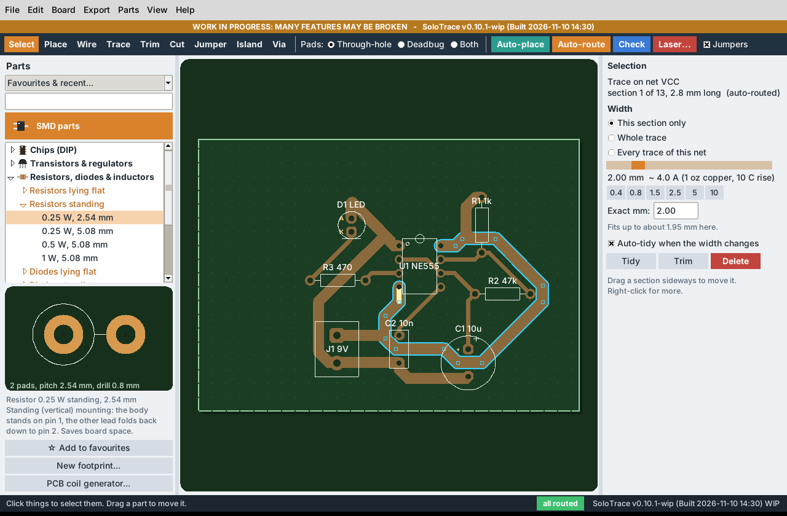](docs/images/gui-routed.webp)

*Screenshots are of the real program running on a Linux test machine with the built-in example boards.*

> **Licence and no warranty.** Copyright Matthew Armstrong. Licensed under the [PolyForm Noncommercial License 1.0.0](LICENSE.md): free to use, change and share for non-commercial purposes; commercial use needs separate permission. It is **source-available, not open source**. GitHub shows the licence as "Other". This is not legal advice. The software is provided **as is, with no warranty and no liability**. Third-party parts keep their own licences ([THIRD_PARTY.md](THIRD_PARTY.md)).
>
> **Safety.** Etching chemicals burn skin and eyes. A diode laser can blind you and start fires, and paint, resist and etchant fumes are harmful: wear laser safety glasses rated for your module, ventilate, never leave a running laser alone. The laser G-code has **never been run on a real machine**. Check every print against your real parts before etching.

## What exists and what does not

| Area | Status |
| --- | --- |
| Place, wire, trace, trim and jumper tools, undo/redo, pan/zoom, flip view | Works in tests and the screenshots; lightly tested by hand |
| Right-click menus (trim, split, tidy, width, rotate, duplicate, wire from a pin, route one net...) | Works in tests and the screenshots |
| Rigid wires (Shift + Wire): a direct power trunk that the rest of the net branches off | Works in tests and on the demo; first suggested from real use |
| Auto-route retries (best of up to 6 net orders) plus a polish pass, jumpers optional globally or per net; the same board always routes the same way (0.8.0) | Works on the test boards; compared with every older version in DESIGN_NOTES.md |
| Cut tool: one click removes a piece of trace from joint to joint (Shift: between two points) | Works in tests |
| Favourites & recently placed parts; Shift + click turns a part while placing | Works in tests |
| Branches stay joined when a trunk is widened, tidied or dragged; DRC warns about hanging trace ends | Works in tests and on rebuilds of real boards |
| Board > Keep traces out from under parts | Works on the test boards; can add jumpers on cramped boards |
| Pin labels (B C E, G D S, K A, IN GND OUT, optocoupler and DIP layouts) and part values on the board | Works; layouts are the common ones for each shape, **check your datasheet** |
| Dragging a trace section sideways (neighbours follow, 45° rules kept) | Works in tests; lightly tested by hand |
| 90 through-hole parts in a form-factor tree with a live preview, footprint wizard, KiCad `.kicad_mod` import | Works; some parts excluded on purpose (see below) |
| Trace width slider 0.4–10 mm (segment, trace or net) + current readout + "fits up to" hint | Works |
| Wide traces leave pads straight and end on the pad centre (auto-tidy) | Works on the test boards; may leave a trace as it was when the tidy shape does not fit |
| Deadbug (surface-solder, no-drill) pads, per part or per pad | Works |
| Copper islands (Island tool): round or rectangular pads you drop, drag and resize; pins on an island join it | Works in tests and the screenshots; new in 0.4.0, not yet used on a real board |
| Ground fill for RF / Manhattan boards: the board is ground copper with a gap round every other net, floating fill removed | Works in tests, the examples and an independent Gerber reader; new in 0.4.0, **never etched yet** |
| Thermal reliefs on ground pads (ring + spokes, sized by hand or for a current; heavy / solid per part) | Works in tests and the examples; new in 0.5.0, **never soldered yet** |
| Back-side ground plane for a double-clad board: vias (Via tool), clearance holes, stitching grid, top-copper Gerber, back prints and laser job, countersink list | Works in tests and the examples; new in 0.5.0, **never built yet** |
| SMD parts (the big **SMD parts / Through-hole parts** button swaps the list): 41 common SMD footprints on the copper side (0603 to 2512, SOT-23/223, DPAK, D2PAK, SOIC, SMA/SMB/SMC, tantalum, electrolytic) | Pad sizes from makers' drawings, checked for 0.3 mm gaps; not yet soldered on a real board |
| **Modules & displays** (new in 0.7.0): 23 microcontroller boards, OLEDs and SD card modules on 2.54 mm headers, pins already labelled, through-hole or deadbug | Pin orders, row spacings and sizes from makers' KiCad/Eagle files and datasheets; a few are single-source (each part's note says which); none plugged into a real etched board yet |
| **Mirror** a part (Shift+M) to mount it under the board, shown with a pink dashed frame and a MIRRORED tag | New in 0.7.0; tested in both UIs |
| **Web UI**: the same editor in your browser, the default since 0.8.0 (`python3 src/main.py`; `desktop` for the tkinter window) | New in 0.6.0; every tool, panel, menu, dialog and export; tested in headless Chromium and by the unit tests; **not yet used by a person on a real design** |
| **In-browser version, nothing to install** ([open it](https://the-dorkknight.github.io/solotrace/app/)): the same code run by Pyodide in the page | New in 0.8.0; tested in headless Chromium with a local copy of Pyodide 0.29.5; **loading Pyodide from the jsDelivr CDN has not been tried** (the build machine cannot reach it) |
| Collisions after moving a part over laid traces: red marks while dragging, a message on drop, part body over traces when mounted under the board | New in 0.8.0; Check compared with a brute-force check on 64 random moves |
| Auto-route algorithm: Auto (negotiated congestion, then classic), Negotiated, Classic | Measured on 11 boards (DESIGN_NOTES.md); new in 0.5.0 |
| Auto-place algorithm: Annealing, Routability (experimental) | Routability measured **no better** than Annealing; off by default |
| Chamfered corners everywhere + DRC | Works |
| Auto-place and auto-route with jumper fallback | Works on the three demo boards and random test boards; **pure Python, can be slow** on big boards |
| Gerber + drill zip, 1:1 PDF/SVG, BOM CSV, netlist text | Written and re-read by an independent Gerber library in tests; **not opened in a fab's own viewer** |
| Laser G-code (negative / isolation / positive, test cards, frame file) | Geometry checked in tests; **never run on a real Elegoo Phecda** |
| Windows and macOS launchers, GitHub workflows | **Not run** (written but untested on those systems) |
| Floating slider pop-up beside the cursor | **Not built**: the slider is in the right-hand panel |
| Topological (rubber-band) router, C++ speed-up | **Not built** (see [DESIGN_NOTES.md](DESIGN_NOTES.md)) |
| Soldermask layer, multi-layer boards, fine-pitch SMD | Out of scope |

## Install and run

### 0. Nothing to install: use it in your browser

Open **https://the-dorkknight.github.io/solotrace/app/** (needs the project's GitHub Pages switched on). The whole editor runs inside the page: [Pyodide](https://pyodide.org) (Python compiled to WebAssembly, about 12 MB downloaded once from the jsDelivr CDN and then cached) runs the same SoloTrace code as the download, in a background worker. Your board is never uploaded: *Save* downloads the `.solotrace` file, *Open* reads one from your computer, exports download. Settings, favourites, your own parts and the autosave stay in the browser's own storage, so they survive a reload. It is slower than the download (Python in WebAssembly; auto-route takes roughly two to three times as long) and auto-route has no Cancel button. Tested in Chromium only; see Known limitations.

[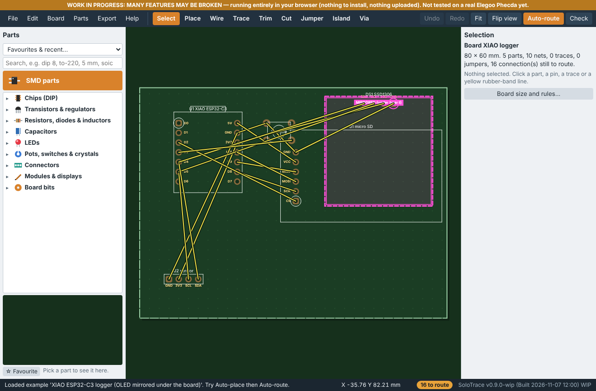](docs/images/web-app.webp)

### 1. Double-click this

| System | Double-click | What it needs |
| --- | --- | --- |
| Linux | `SoloTrace-Linux.sh` (if asked, choose **Run**) | `python3` (3.8+) |
| Windows | `SoloTrace-Windows.bat` | Python 3.8+ from [python.org](https://www.python.org/downloads/windows/) |
| macOS | `SoloTrace-Mac.command` (first time: right-click > Open) | Python 3.8+ |

If Python is missing, the launcher shows a message with the exact fix (and the address of the browser version). Nothing else is needed: SoloTrace uses only the Python standard library and sends nothing over the network.

**It opens in your web browser; tkinter is no longer needed.** Since 0.8.0 the launcher (and `python3 src/main.py`) always starts the **web UI**: a tiny local server on `127.0.0.1` (never on the network) plus the same editor as a web page, which opens in your default browser. Every tool, the right-click menus, the panels, the dialogs, the ground fill, the back-side plane, DRC and all the exports are there; *Save* downloads the `.solotrace` file and *Open* reads one from your computer. The old desktop window (tkinter) is still there for those who like it: `python3 src/main.py desktop` (if tkinter is missing it says so and opens the browser instead). *File > Quit* stops the server; it also stops by itself about a minute and a half after the page is closed.

[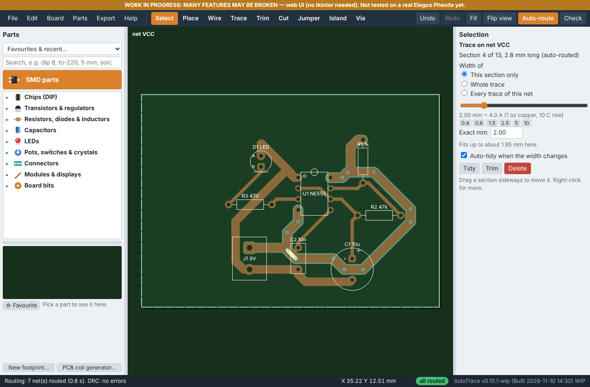](docs/images/web-ui.webp)

Linux Mint / Ubuntu / Debian: `sudo apt install python3` (plus `python3-tk` only if you want the desktop window). If the double-click does nothing, right-click the file > Properties > Permissions > "Allow executing as program", or run it from a terminal.

### 2. From a terminal

```
python3 src/main.py                  # open the editor in your browser (local server on 127.0.0.1)
python3 src/main.py desktop          # the tkinter desktop window instead
python3 src/main.py web board.solotrace --port 8321 --no-browser   # a fixed port, open the address yourself
python3 src/main.py --version        # version line
python3 src/main.py --demo           # open the 555 example
python3 src/main.py demo "5 V regulator" board.solotrace
python3 src/main.py route board.solotrace routed.solotrace
python3 src/main.py islands board.solotrace rf.solotrace --deadbug   # ground fill on (--off turns it off)
python3 src/main.py route board.solotrace routed.solotrace --algorithm negotiated
python3 src/main.py place board.solotrace placed.solotrace --placer routability
python3 src/main.py export routed.solotrace --gerber out.zip --pdf out.pdf --laser out.gcode --mode negative
python3 src/main.py selftest         # run the tests
```

The first time it starts it shows a safety and work-in-progress notice; tick the box and click **I agree**. Closing that window quits.

## Quick tour: your first board in 5 minutes

1. **File > Open example > 555 LED flasher** (or **File > New board** and set a size).
2. **Place parts:** pick from *Favourites & recent* at the top of the parts panel, or open a group in the parts panel on the left (the little arrows show the sub-types, such as *Resistors standing*), pick a part, check the drawing under the list, then click on the board. Or type in the search box (`dip 8`, `to-220`, `standing`). `R` or Shift + click turns the part, `Esc` stops placing. Star parts you use a lot with the button under the preview.
3. **Wire:** press `W`, click one pin, then another (or drag from pin to pin). A yellow rubber-band line shows the connection. Hold **Shift** for a **rigid wire** (see below). Click a rubber-band line to name its net or give it a class (Signal 0.8 mm, Power 2 mm, High current 5 mm; change them in Board > Board size and rules).
4. **Auto-place, then Auto-route** (toolbar). A progress bar with **Cancel** shows while it works. Routes use 0°, 45° and 90° moves, and a 90° turn is always built as two 45° turns (a chamfer). If a trace can't get through, a **wire-link jumper** (blue dashed) is added on the component side.
5. **Label:** select a part and type its *Value / type* (NE555, BC547, 10k...), and pick its *Pin labels* (B C E, G D S, IN GND OUT...).
6. **Tweak:** drag a trace section sideways to move it, use **Trim** (`X`) to cut a section out, and **right-click** anything for its menu.
7. **Check**, then **Export**.

**Quick and dirty RF (Manhattan / deadbug):** *File > Open example > Manhattan RF amplifier (copper islands)*. Press `I` and click to drop copper islands, sit the parts' pins on them, and tick *Board > Ground fill*. No traces needed.

[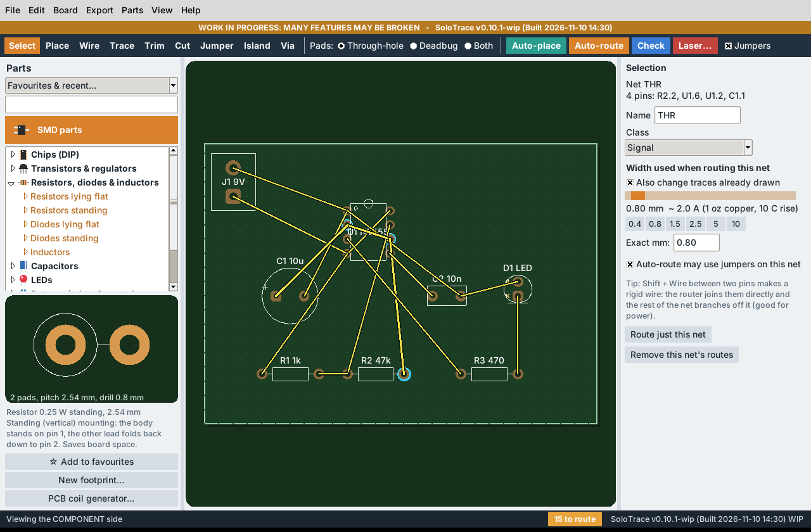](docs/images/gui-ratsnest.webp)

### Feature by feature

**Library and parts.** 90 through-hole parts plus 23 modules and 41 SMD parts, sorted by shape (form factor) rather than by maker code. Each group has an arrow that opens its sub-types:

| Group | Sub-types |
| --- | --- |
| Chips (DIP) | Narrow (7.62 mm rows) DIP-4 to DIP-28, wide (15.24 mm rows) DIP-28 and DIP-40 |
| Transistors & regulators | TO-92, TO-220 (2-pin, 3-pin, with heatsink outline), TO-247 / TO-3P |
| Resistors, diodes & inductors | Resistors lying flat (1/4 W to 5 W), **resistors standing (1/4 W at 2.54 and 5.08 mm, 1/2 W and 1 W at 5.08 mm)**, diodes lying flat and standing, axial and radial inductors |
| Capacitors | Ceramic disc, film / box, electrolytic |
| LEDs | 3 mm and 5 mm |
| Pots, switches & crystals | Inline pots (2.54 and 5.08 mm), triangle trimmer, 6 mm tactile switch, HC-49 crystal |
| Connectors | Pin headers 1-row and 2-row, screw terminals, JST-XH |
| Board bits | Wire links, mounting holes, solder and surface pads |
| My parts | Parts you made or imported |

Click a part and a drawing of it (copper, holes, outline, pin numbers, pitch and drill) appears under the list, in the sidebar, with no pop-up. Names say what the part is ("Electrolytic cap, 5 mm pitch"), not an obscure model number. Left out on purpose because their sizes vary too much between makers: relay, USB-B, barrel jack, buzzer, fuse holder, panel pots with lugs, TO-126, bridge rectifiers. Make those with the wizard. Body outlines, the inductor, pot and trimmer layouts, and the standing-part pitches are generic: check them against your real part.

**Your own parts.** *Parts > New footprint...* opens the wizard: type a pad table (name, x, y, pad size, drill), or click on the canvas to drop pads, or start from a DIP or header preset, then save. Saved parts live in `~/.solotrace/parts` (*Parts > Open my parts folder*). *Parts > Import KiCad .kicad_mod...* reads the text format of a KiCad footprint (through-hole pads and silkscreen lines only).

[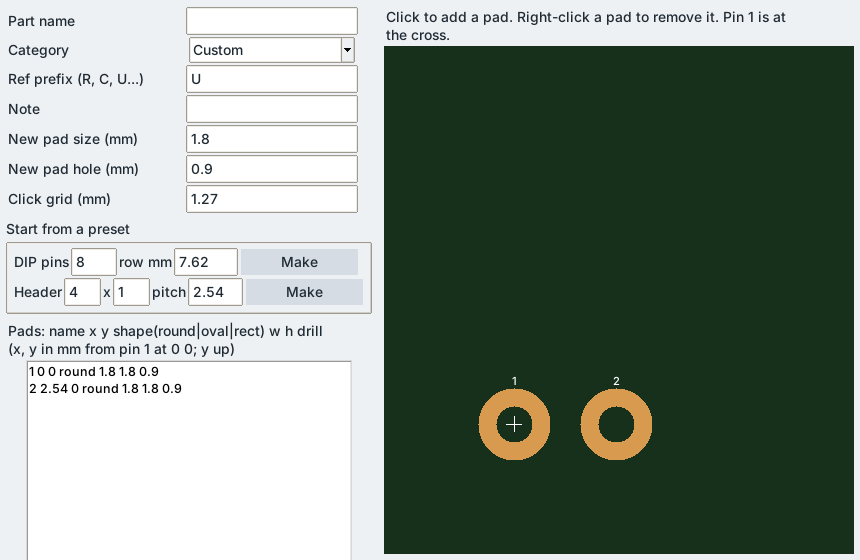](docs/images/footprint-wizard.webp)

**Trace width.** Press `T` and click along the board to draw a trace (`Enter`, a double-click or *Finish trace here* on the right-click menu finishes it; corners are chamfered for you). To change a width, click a **trace section** on the drawing, or click a **yellow rubber-band line** to set the width of a whole net, then drag the **slider** in the right panel (0.4–10 mm; preset buttons 0.4, 0.8, 1.5, 2.5, 5, 10). Choose whether it applies to the section, the whole trace or the whole net. The panel shows roughly how many amps that width carries (IPC-2221 outer-layer formula; board settings give copper weight and temperature rise; a guide only) and how wide the trace can go where it is before it breaks the clearance rule.

**Rigid wires (power trunks).** A net with more than two pins is normally routed by joining the nearest pins first, so a ground net can end up as one long chain (transistor to capacitor to terminal). If you want a direct trace between two particular pins, hold **Shift** while wiring them (click or drag), or right-click a pin > *Rigid wire from this pin*, or right-click an existing rubber band > *Make ... rigid*. The router routes every rigid pair first, as its own pin-to-pin trace, then connects the rest of the net to the nearest point of that trunk, so a capacitor becomes a short branch. "Rigid" fixes *which* two pins are joined, not the path: the trunk bends round other parts like any trace, can be moved by a re-route, and you can drag or cut it. Rigid rubber bands are thicker and orange. Once routed, the trunk is drawn in the same copper colour as everything else, so joints look like the one piece of copper they will be, with a thin dashed orange line down its middle to show it is a rigid wire. Branches stop inside the trunk instead of poking out of its far side, and when you drag a trunk sideways the branches joined to it move with it and stay joined. The net panel lists the rigid pairs, each with a *make normal* button.

[](docs/images/gui-pin-labels.webp)

**Copper islands (Island tool, `I`).** Free-standing pads for Manhattan / deadbug building. Click on the board to drop one (5.08 mm square to start), or drag to draw one any size; Shift + click switches new islands between rectangular and round. With *Select*, drag an island to move it (0.635 mm steps, so it can sit under pins) and drag one of its white corner squares to resize it while the opposite corner stays put. The right panel takes an exact width, height and corner cut (rectangles get 45 degree corners like everything else; a round island with a different width and height is an oval), offers square/circle sizes from 2.54 to 15.24 mm, and has *Turn 90*, *Duplicate* (`Ctrl+D`) and *Delete*; arrow keys nudge it. Right-click an island for the same choices, or right-click empty board > *Add a copper island here*. An island hidden under a part's body: click the part, then click it again to pick the island.

An island has no net of its own: it **joins the net of whatever touches it**, a pin, a trace or a jumper pad, and islands that touch each other share a net. So sit a part's pins on islands (deadbug pads make that easy) and the connection is made, with no trace. The panel says which net an island is on and which pins sit on it. If pins of two different nets end up on one island, that is a short and *Check* reports it. The router treats islands as copper and routes round them, and they appear in every export.

[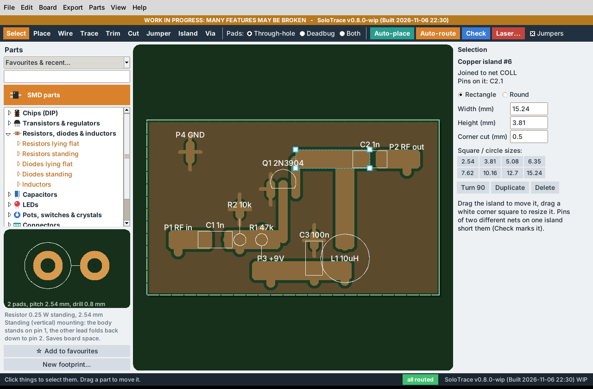](docs/images/gui-islands.webp)

**Ground fill (Board > Ground fill).** For quick and dirty RF and fast analogue: the whole board becomes copper, used as ground, and every other net is cut free from it with a gap. Settings are under *Board > Ground fill settings...*:

- **Ground net:** guessed (a net called GND, 0V, VSS, ground... otherwise the net with the most pins), or pick one; the net panel also has *Use this net as the ground fill*. The ground net is joined by the fill, so Auto-route does not route it, and its old automatic traces are removed when you turn the fill on.
- **Gap** round everything else (default 0.6 mm, never less than the board's copper-to-copper gap). For laser etching keep it at least 3 to 4 line intervals.
- **Fatten other nets' copper** by up to this much (default 1 mm): routed traces and pads grow into wide, low-inductance patches, but only where that keeps the gap from other nets, ground copper and the board edge. Copper islands you placed keep their size.
- **Remove floating fill** (on by default): a piece of fill that no ground pin sits on, boxed in by other nets, is cut away rather than left as floating copper. A ground pin that sits on a piece of fill cut off from the rest gets a yellow rubber band; join it with a trace or a jumper.
- Turning the fill on offers to make every pad a **deadbug pad**, since such boards are usually built with the parts soldered straight onto the copper.

The fill is drawn in the editor and is in the Gerber, the PDF/SVG prints and the laser G-code. In negative laser mode the laser then burns only the gaps (much faster); isolation mode burns the same thing on such a board.

[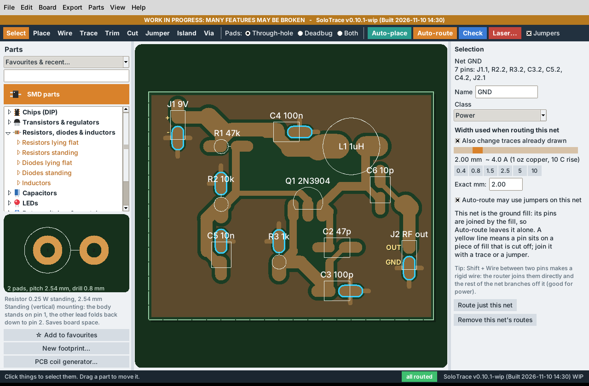](docs/images/gui-ground-fill.webp)
[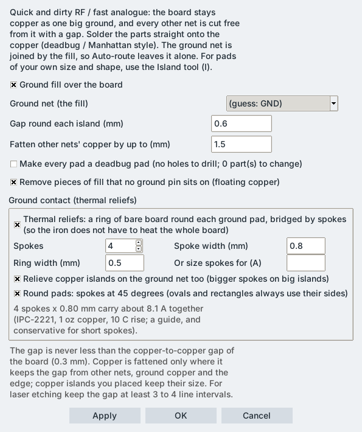](docs/images/islands-dialog.webp)

**Thermal reliefs (ground contact).** A pad joined solidly to a big copper fill is hard to solder: the fill takes the heat away faster than a hobby iron supplies it. So every ground pad gets a **ring of bare board bridged by spokes** (a thermal relief), in the ground fill and in the back-side plane. *Board > Ground fill settings > Ground contact* sets the number of spokes (default 4), their width (default 0.8 mm) and the ring (0.5 mm), and shows the current the spokes carry together (IPC-2221 outer-layer formula, 1 oz copper, 10 °C rise: four 0.8 mm spokes are good for about 8 A). Ground usually carries the return current of the whole board, so there is also **"size spokes for N amps"**: type the current and the spoke width is worked out for you. Round pads get radial spokes at 45°; deadbug ovals, rectangular pads and copper islands get spokes off their flat sides and ends (never a corner); islands over 4 mm get spokes scaled to their size. In a part's panel, *Ground contact* can be set to **heavy** (spokes twice as wide) or **solid** (no relief: for the heavy-current pads and for decoupling capacitors and RF grounds, where the industry rule is a direct connection). *Check* warns when the ground net's trace class is good for more current than its reliefs carry. A spoke that would touch another net is dropped, and a pad that would lose all its spokes stays solid, so a relief never cuts a pad off. Research and sources: [docs/research/thermal-reliefs.md](docs/research/thermal-reliefs.md).

[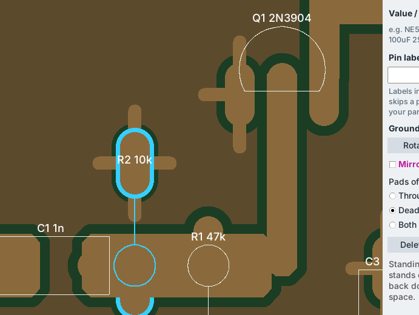](docs/images/thermal-reliefs.webp)

**Back-side ground plane (double-clad board).** *Board > Back-side ground plane* uses the component side of a double-sided copper-clad board as one solid ground plane while all traces stay on the copper side as usual. Every ground lead that passes through the board is soldered on both sides; a **via** (Via tool, `V`; a hole with a bit of bare wire through it, soldered both sides) joins deadbug or SMD ground pins, ground islands and the ground fill to the plane; every other hole gets a bare ring in the plane (default hole + 1.1 mm: 0.25 mm of electrical clearance plus 0.3 mm for front-to-back misalignment). The dialog has *Via at every ground pin without a hole* and *Add stitching vias* (a grid, default 10 mm), and says up to what frequency that spacing keeps the plane and the front ground one low-impedance mesh (lambda/20 in FR4: 10 mm is good to about 700 MHz).

The "big LC circuit" worry: two copper sheets joined at one point do form a resonant cavity, but on a 100 mm FR4 board its first resonance is near 700 MHz, far above most hobby circuits, and joining the sheets at every ground pin plus a loose grid of vias turns the cavity into a mesh, which is exactly how commercial multilayer boards are built. What you gain even at audio and low MHz: every trace has its return path directly underneath, so loops, crosstalk and radiated noise shrink. Sources and the numbers: [docs/research/back-side-ground-plane.md](docs/research/back-side-ground-plane.md).

Two ways to make the back: (1) **etch or burn it**: *Export > Gerber* gains a top-copper layer, *Export > Back-side ground plane* gives a 1:1 PDF/SVG (seen from the component side, so not mirrored), and the laser dialog has a *Back-side ground plane* choice (burns only the rings and reliefs); front-to-back registration must then be within the ring allowance. (2) **Leave it solid**, the ham way: drill every hole, then clear the copper round each non-ground hole with a 2 to 2.5 mm drill tip or countersink; *Export > Countersink list* lists those holes, and nothing needs aligning. Ground leads and vias get thermal reliefs in the plane (same spoke settings) so they can be soldered. *Check* reports a via whose back-side connection a clearance ring would cut, a ground lead trapped inside another hole's ring, a plane nothing joins, and a note on how far the stitching is good for.

[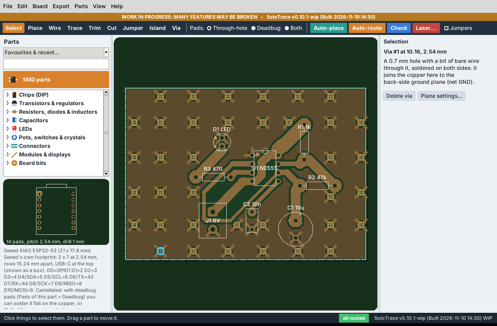](docs/images/gui-back-plane.webp)
[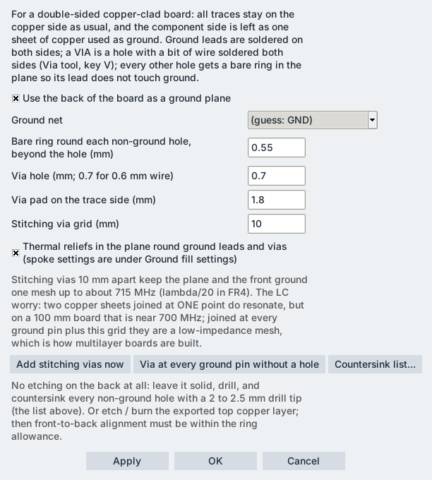](docs/images/back-plane-dialog.webp)

**SMD parts.** The big **SMD parts** button under the parts search (with the little SOT-23 picture) swaps the whole list for the SMD parts; it then reads **Through-hole parts** (with a TO-92 picture) and clicking it again brings the normal list back. The SMD list holds the common, large, hand-solderable surface-mount packages (chips 0603 to 2512; SMA, SMB, SMC, SOD-123, MELF diodes; SOT-23 with 3, 5 and 6 pins; SOT-223; DPAK and D2PAK; SOIC-8/14/16 narrow, SOIC-16 to 28 wide, SOP-8 5.3 mm; tantalum cases A to D; SMD electrolytics 4 to 10 mm; two shielded inductors). Every pad size is taken from a maker's land-pattern drawing (TI, Diodes Inc, Vishay, KEMET, Nichicon, Sumida), using the roomier wave-solder or "level A" pattern where there was a choice, and every gap between pads is at least 0.3 mm, so the parts can be soldered without a solder mask; finer packages (SOT-363, TSSOP, TQFP) are left out on purpose. SMD parts sit on the **copper side**: in the component-side view they appear mirrored, press `M` to see the board as you will solder it; their outlines go to a bottom silkscreen Gerber and they have no holes. Pin-label presets cover SOT-23 transistors and MOSFETs, SOT-223 and DPAK regulators and transistors, and the SOIC equivalents of the DIP layouts. SoloTrace stays a through-hole program first: it starts in through-hole mode and remembers which list you had open. Where the numbers came from, and what was left out and why: [docs/research/smd-land-patterns.md](docs/research/smd-land-patterns.md).

[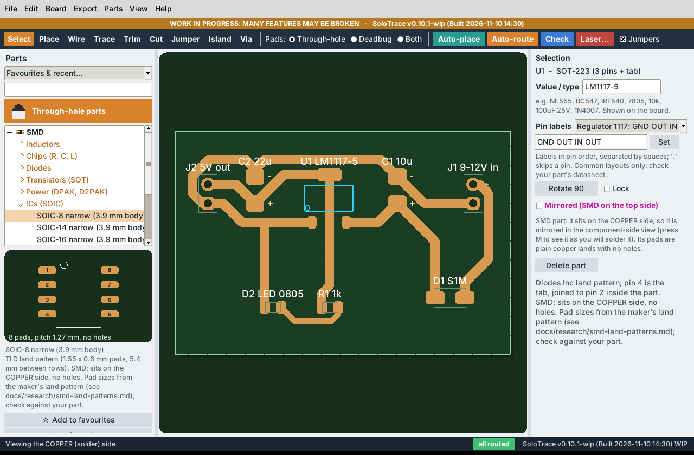](docs/images/gui-smd-pro.webp)
[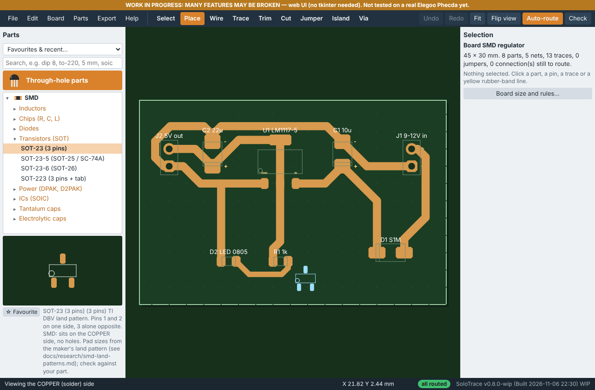](docs/images/web-ui-smd.webp)

**Modules & displays.** A new group in the through-hole list holds the boards people actually build with, each on 2.54 mm headers with every pin already labelled as it is printed on the module:

| Sub-group | Boards |
| --- | --- |
| ESP32-C3 / S3 mini (postage stamp) | Seeed XIAO ESP32-C3 and ESP32-S3 (21 x 17.8 mm, 2 x 7), ESP32-C3 SuperMini (22.5 x 18 mm, 2 x 8), Waveshare ESP32-S3-Zero (23.5 x 18 mm, 2 x 9) |
| RP2040 | Raspberry Pi Pico and Pico W (2 x 20, 17.78 mm rows), Waveshare RP2040-Zero (9 + 9 + 5 along the bottom), Seeed XIAO RP2040 |
| ESP32 dev boards | DOIT DevKit V1 30-pin, Espressif DevKitC 38-pin (both 25.4 mm rows) |
| ESP8266 | NodeMCU v2 Amica (22.86 mm rows), NodeMCU v3 LoLin (27.94 mm rows), WEMOS / LOLIN D1 mini, ESP-01 |
| Arduino | Nano, Pro Mini (with or without the FTDI header), Pro Micro |
| OLED displays | 0.96 inch 128x64 I2C (4 pins), 0.91 inch 128x32 I2C (4 pins), 0.96 inch 128x64 SPI (7 pins) |
| SD card | the blue 5 V micro SD SPI module (42 x 24 mm) and the small 3.3 V one |

Every board works both ways: through-hole (solder header pins and plug the module in, or solder it straight down), or **deadbug** (*Pads of this part > Deadbug*): no holes, longer pads, so a castellated "postage stamp" board (XIAO, SuperMini, Zero, Pico) can be soldered flat onto the copper, or header pins bent flat. Each part's note gives the GPIO number behind every pin name and says where the data came from; where the sources were thin or disagreed (the SuperMini's exact position along the board, the ESP32-S3-Zero and RP2040-Zero outlines, the DOIT board outline, the SPI OLED's header position, the SD modules' pin order), the note says so. Some sellers swap VCC and GND on the OLEDs: *Pin labels* has *VCC GND SCL SDA* for those. Always check the print on your module before etching. The research, with a source and a confidence word for every number: [docs/research/mcu-modules.md](docs/research/mcu-modules.md).

**Moving a part after routing.** Traces do not follow a part. When you drag a part over laid copper, every pad and trace it would touch is ringed in red as you move (in the browser the ghost turns red), and when you let go the status bar says how many collisions there are: drag it clear, or right-click it > *Route this part's nets*. The same happens when you turn, nudge, mirror, duplicate or place a part. *Check* also warns when a module mounted under the board and soldered flat would sit on another net's trace.

[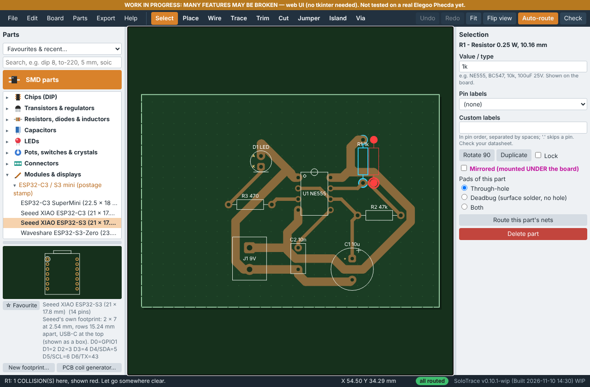](docs/images/web-ui-collision.webp)

**Mirrored parts (under the board).** **Shift+M** (or right-click > *Mirrored*, or the tick box in the part's panel) mounts a part on the other side: a display that should look out of the copper side, a module plugged in from below so the board sits flat in a box. Its pins swap left to right in the component-side view (the part flips about its pin 1), its outline moves to the bottom silkscreen, the BOM says *copper side (MIRRORED)*, and *Check* lists it as a reminder. While placing, Shift+M places the next part mirrored. A mirrored part is drawn so it can't be missed: a thick dashed **pink** frame, a pink *MIRRORED (under board)* band, pink outline, and a pink note in the panel. (SMD parts already live on the copper side, so they are only shown pink if you mirror one onto the component side.) Example: *File > Examples > XIAO ESP32-C3 logger*, with its OLED mirrored under the board.

[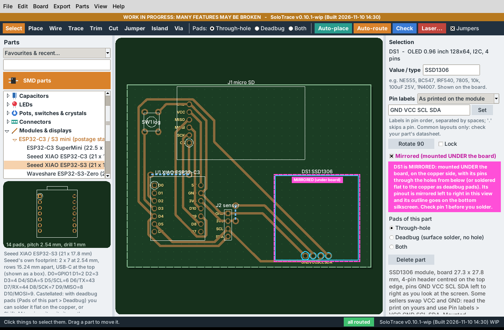](docs/images/gui-modules-mirrored.webp)
[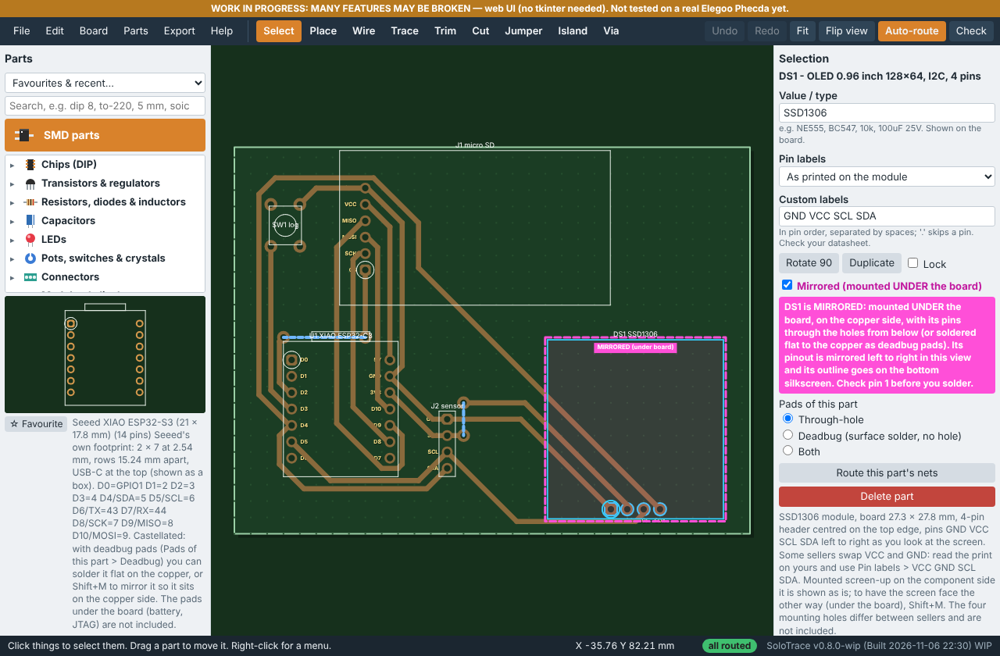](docs/images/web-ui-modules.webp)

**Values and pin labels.** Select a part: *Value / type* at the top of the right panel takes anything (NE555, BC547, IRF540, 7805, 10k, 100uF 25V) and is shown next to the part name on the board; double-click a part to jump to it. *Pin labels* offers the common layouts for that shape, not specific part numbers:

| Shape | Layouts offered |
| --- | --- |
| TO-92 | E B C, C B E, B C E, D G S, G D S, S G D, small regulator OUT GND IN / IN GND OUT |
| TO-220 3-pin | power transistor B C E, MOSFET G D S, IGBT G C E, regulator IN GND OUT, adjustable regulator ADJ OUT IN, negative regulator GND IN OUT, triac MT1 MT2 G, dual diode A K A |
| TO-220 2-pin | diode K A / A K |
| TO-247 | G D S, G C E, B C E |
| DIP-4 / DIP-6 | optocoupler A K E C; optocoupler with base pin; opto-triac |
| DIP-8 | 555-style timer, dual op-amp, single op-amp, dual optocoupler |
| DIP-14 / 16 / 20 | logic GND and VCC pins; quad op-amp (DIP-14) |
| Pots, connectors | 1 W 3, CCW W CW; + -, - +, AC AC, IN OUT, V+ GND V-, IN GND OUT |

Or type your own in pin order, separated by spaces (`.` skips a pin). Diodes and LEDs show K A, electrolytics + -, without asking. Pin orders differ between makers, so **always check the datasheet** of the part you have. Labels are shown in the editor; they are not yet written into the Gerber silkscreen.

**Wide traces are tidied.** When a trace is 1.2 mm or wider, SoloTrace makes it leave each pad with a straight vertical or horizontal run (about the pad radius plus the trace width) before it turns, ends it exactly on the pad centre, and makes the chamfers bigger where there is room. This happens after auto-routing and, with *Auto-tidy when the width changes* ticked (the default), whenever you change a width. If the tidier shape would touch other copper the trace is left as it was, and the clearance problem is marked in red. *Tidy* (right panel or right-click) does it on demand; *Edit > Tidy all traces* does the whole board.

[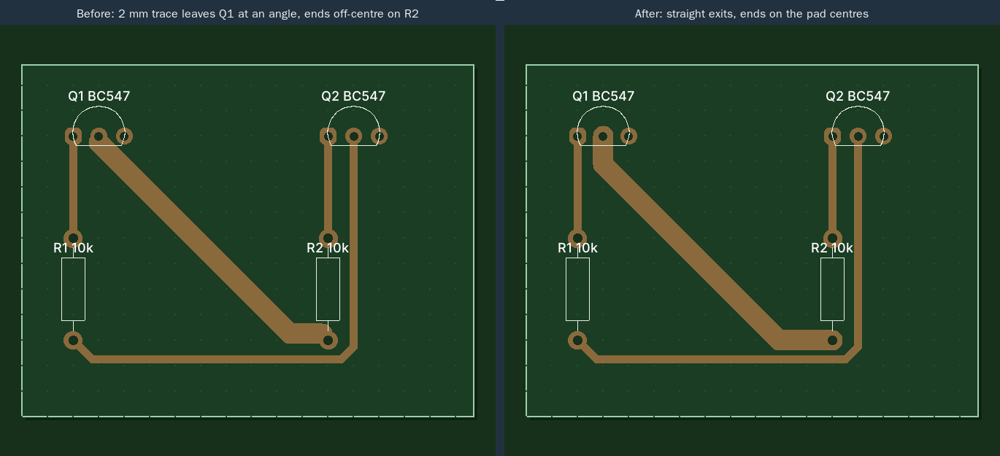](docs/images/wide-trace-tidy.webp)

**Cutting a piece out of a trace.** Press `C` and click a trace: the piece under the mouse goes, from the joint before it to the joint after it (a pad, a place where another trace meets it, a jumper pad). The rest of the trace and of the net stays. While you hover, the piece that would go is shown in red. Right-clicking a trace only opens its menu; rest the mouse on *Cut this piece* to see the piece in red, and choose it to remove it. To cut between two points of your own choosing, Shift + click the first point and Shift + click the second (or right-click > *Cut between two points*); `Esc` cancels.

**Moving, trimming and splitting traces.** With *Select*, drag a trace section sideways: it moves parallel to itself and the sections either side stretch to follow at their own angle, so no 90° corner appears. Ends on pads stay put (a 45° link is added). **Trim** (`X`, or right-click > *Trim this section*) cuts one section out and leaves the rest as separate pieces; *Split trace here* breaks a trace in two without removing copper. A trace you have moved or trimmed counts as hand-drawn, so Auto-route keeps it. `Ctrl+Z` undoes any of this.

**Right-click menus.** Right-click (without dragging) on a trace, pin, part, rubber-band line, jumper or empty board for the actions that fit: widths, trim, split, tidy, highlight or re-route the net, rotate either way, duplicate, lock, pad styles, wire or trace from a pin, disconnect, delete, and Undo/Redo. Right-drag still pans.

[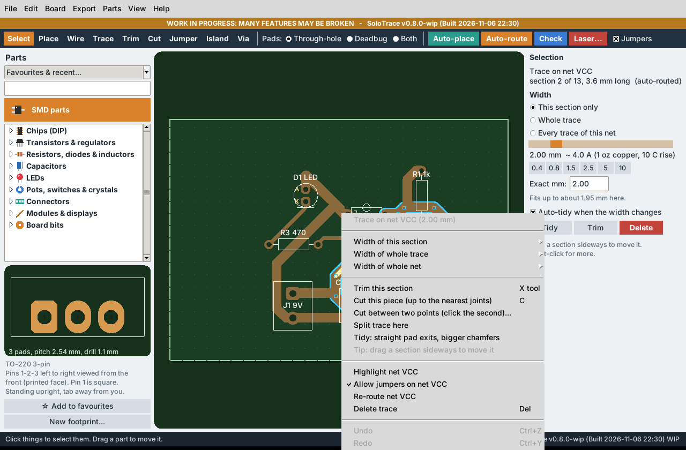](docs/images/gui-context-menu.webp)

**Small helpers.** Hover over copper to light up its whole net (the net name shows in the corner). Arrow keys nudge the selected part by 1.27 mm (`Shift`: 2.54 mm), `Ctrl+D` duplicates it, `Shift+R` turns it back, `Shift+M` mirrors it (mounts it under the board). *File > Open recent* lists your last boards. While a board has unsaved changes it is saved every 2 minutes to `~/.solotrace/autosave.solotrace`; *File > Recover autosave* opens it (the file is removed when you quit normally). Hover over a toolbar button for a hint. The status bar shows the cursor position in mm and a green *all routed* or orange *N to route* badge.

**Pads: through-hole or deadbug.** Pick *Through-hole*, *Deadbug* or *Both* in the toolbar for new parts, or change it for a placed part in the right panel, or for one pad ("This pad only"). Deadbug pads have **no hole** and are drawn as a long oval that sticks out from the part so you can bend the lead flat and solder it on the copper side. "Both" keeps the hole *and* the extra copper.

[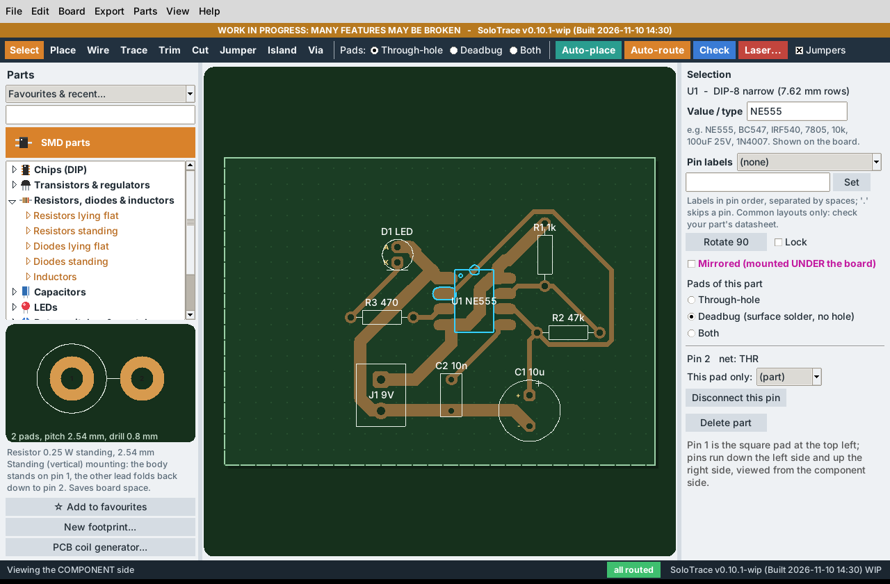](docs/images/gui-deadbug.webp)

**Auto-place.** Simulated annealing that moves, rotates and swaps unlocked parts to shorten the ratsnest and cut crossings. Tick **Lock** on a part to keep it where it is. *Board > Auto-place algorithm* also offers **Routability** (experimental): the same moves plus an estimate of where copper will not fit (RUDY congestion) and a penalty for pads boxed in by other parts, with VPR's adaptive cooling. In measurements it was **no better** than Annealing (DESIGN_NOTES.md), so Annealing stays the default.

**Auto-route.** A grid router that remembers its heading, so it prefers straight runs and clean 45° bends instead of staircases, and prefers not to run under part bodies. Three ways to drive it (*Board > Auto-route algorithm*):

- **Auto** (default): negotiated congestion first; if that leaves a connection unrouted or needs a jumper, the classic tries follow within the time budget, and the best result is kept.
- **Negotiated congestion**: the PathFinder method FPGA tools use. Every net is routed at once, overlaps allowed; then the price of every contested cell rises pass after pass (and a history cost remembers where fights happened) until the nets have sorted themselves out, usually in 3 to 15 passes. A jumper is just another priced resource, dear until contested copper is dearer. It does not depend on the net order, so it needs no retries. On eleven test boards: everything routed, the same number of jumpers as classic, 7 to 9 % less copper, about two-thirds of the time.
- **Classic**: one net at a time against hard obstacles, wide nets first; a blocked net tears up the nets in the way and retries; a jumper is the last resort (unless **Jumpers** is unticked in the tool bar or for that net). The job is tried with up to six net orders (about 12 seconds at most, plus the try in progress) and the best result is kept.

After the best try is chosen, a **polish** step routes each net once more against the finished board and keeps the new copper only if it has fewer jumpers or is shorter, so it never makes a board worse. The same board always routes the same way (before 0.8.0 it could differ from run to run). How it compares with the first versions: DESIGN_NOTES.md (fewer jumpers than 0.3.4 on the test boards, the same total copper; sometimes a longer path where it saves a jumper).

Traces you drew by hand are kept by all three. *Board > Remove automatic routes* undoes only the automatic ones.

**Jumpers.** Press `J` to add one by hand. They are plain wire links on the component side, in 2.54 mm steps from 5.08 mm. They are listed in the DRC window.

**View.** `M` flips between the **component side** (how you place parts) and the **copper side** (how the etched board looks from below). Wheel zooms, right or middle drag pans, right-click opens the menu, `F` fits the board.

[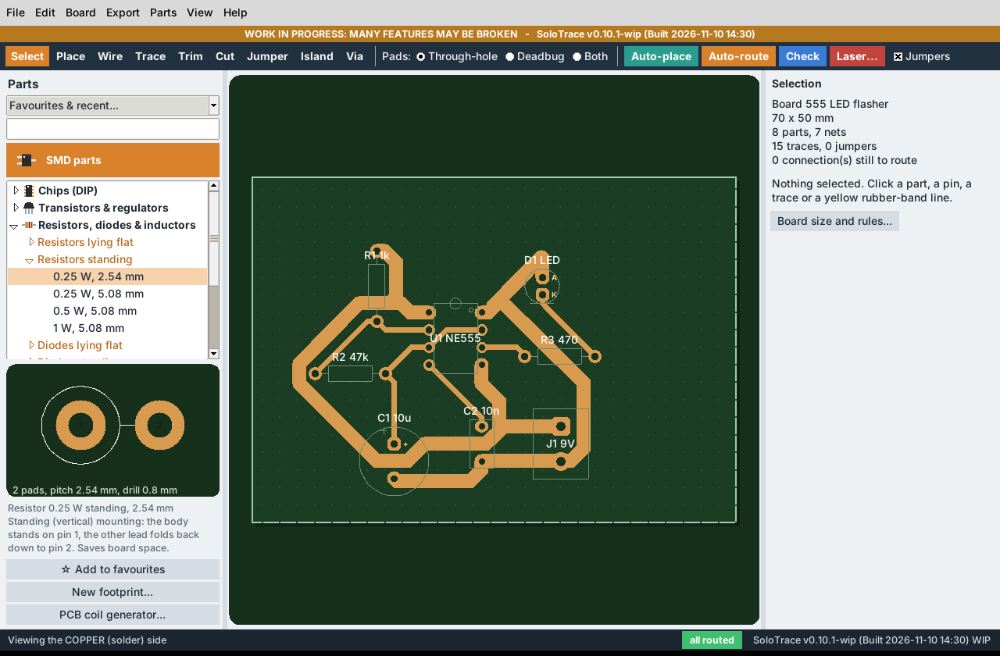](docs/images/gui-copper-side.webp)

**DRC.** *Check* lists trace ends that are not joined to anything ("dangling"), copper too close to other copper or the board edge, parts sticking out of the board, traces thinner than the minimum, turns sharper than 45°, drilled pads with too little copper ring, jumpers that are the wrong length or cross each other, and pins that are not connected yet. Click a row to jump to it on the board.

**Exports (Export menu).**

| Output | Use |
| --- | --- |
| Gerber + drill (zip) | Copper (bottom), board edge, silkscreen, Excellon drill. Single layer; **no soldermask layer** |
| 1:1 PDF / SVG, mirrored | Toner transfer or photo-resist film: the copper side as you will see it. Always print at 100 % and **measure a known distance** before etching |
| 1:1 PDF, design view | Component-side print |
| Bill of materials (CSV) | Parts grouped by name and value |
| Netlist text | Round-trip text format for a quick board from a text editor |
| Laser G-code (Elegoo Phecda) | See below |

## Laser etching with the Elegoo Phecda (gantry diode laser)

**Read this first.** A diode laser cannot remove bare copper. The method is: **paint** the copper, let the laser **burn the paint away** where copper must go, **etch**, then clean the paint off. Nobody has run these files on a Phecda yet. Treat every default as a starting guess and use the test cards.

1. Finish the board and run DRC. Open **Export > Laser G-code (Elegoo Phecda)...**
2. **Mode**
   - **Negative** (default): burns everything that is *not* copper, so paint is left only on the traces and pads. Slowest, cleanest.
   - **Isolation**: burns only a band of `gap` mm around the copper. Fast; leftover paint between bands must be cleared by hand or by the etchant.
   - **Positive**: burns the copper shapes themselves (for a negative-working resist or marking).
3. **Adjust** (all live-previewed):
   - *Trace adjust* (mm per side): positive grows the copper, negative thins it and widens every gap between traces. Use this to correct for the laser's spot size and your etch.
   - *Gap* (isolation band width) and *Border* (keep paint at the board edge).
   - *Line interval* (default 0.08 mm; the module's spot is about 0.06–0.13 mm depending on model), *feed* (default 1500 mm/min), *power* (default 70 % of S max), *passes*, *crosshatch* (second pass at 90°), *bidirectional* scanning, *M4 dynamic power* (default) or *M3 with overscan*, and *drill dots* (a tiny burn at every hole centre as a drilling guide).
4. Click **Save G-code...**. Also use **Frame file...** (traces the board outline at 1 % power so you can line up the paint) and, on first use, **Speed/power test...** and **Trace/gap test...** (a grid of squares and a ladder of fine traces and gaps).
5. In LaserGRBL or LightBurn: jog the laser to the **lower-left corner of the board as seen from the copper side**, set work zero there, open the file, check the preview, run the frame, then burn. The exporter mirrors X for you because the design view is the component side.
6. Controller assumptions: GRBL-style, `$30` equal to the S max in the dialog (default 1000) and `$32=1` (laser mode). The Elegoo manual names LaserGRBL and LightBurn but does not say "GRBL"; see [docs/research/phecda-laser-notes.md](docs/research/phecda-laser-notes.md).

[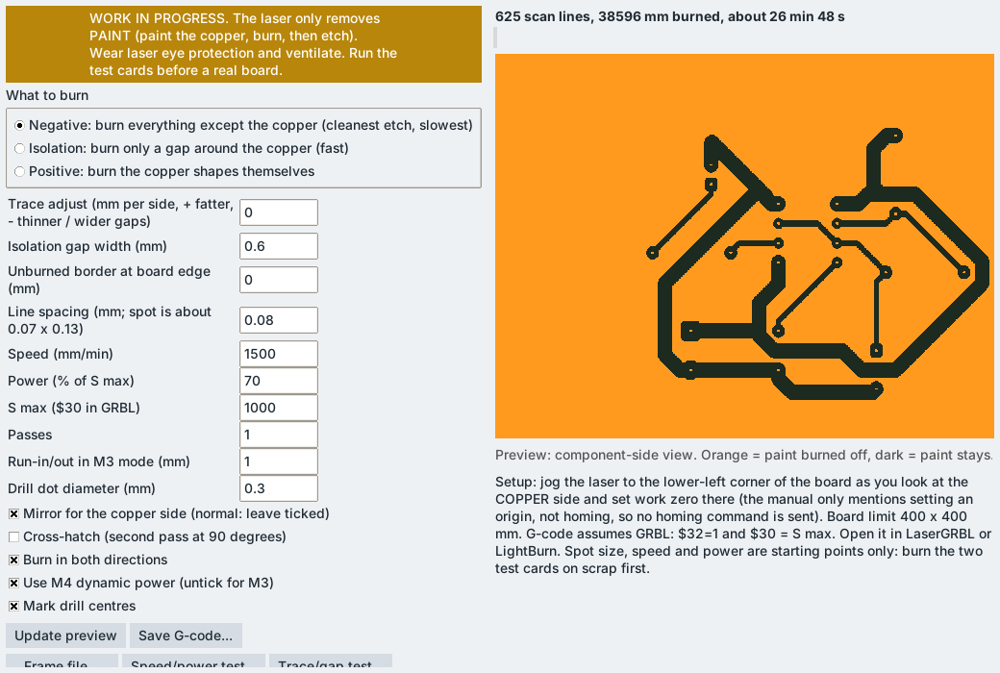](docs/images/laser-negative.webp)
[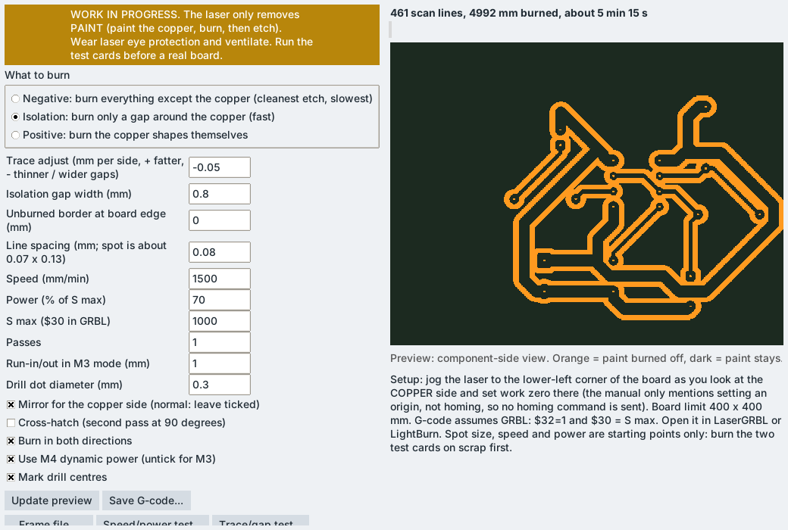](docs/images/laser-isolation.webp)

Examples to look at without installing anything: [examples/](examples/) has nine boards (the 555 flasher, 5 V regulator, 555 power oscillator, logic mix, RF oscillator with ground fill, Manhattan RF amplifier, SMD regulator, a XIAO ESP32-C3 logger with its OLED mirrored under the board, and the 555 flasher with ground fill *and* back-side plane), each with its `.solotrace` file, Gerber zip, 1:1 copper-side SVG and PDF, BOM and laser G-code in both modes; the back-plane one also has the back-plane PDF/SVG, its laser job and the countersink list. Plus [test cards](examples/test-cards).

## Troubleshooting

| Problem | Try |
| --- | --- |
| Double-click does nothing on Linux | Right-click > Properties > Permissions > allow executing; or `bash SoloTrace-Linux.sh` |
| "tkinter is missing" | Only `main.py desktop` needs tkinter; everything else runs in your browser. For the desktop window: `sudo apt install python3-tk` (Linux), reinstall Python with "tcl/tk" ticked (Windows), install Python from python.org (macOS) |
| The web UI page says the server did not answer | The local server stopped (Ctrl+C in the terminal, the computer slept for a long time, or the page was closed for more than a minute and a half). Double-click the launcher again; an unsaved board is autosaved every 2 minutes (*File > Recover autosave*) |
| The in-browser version stays on "Downloading Python" | It needs to reach `cdn.jsdelivr.net` once (a firewall, an ad blocker or a school network may block it). Use the download and a launcher instead |
| A part I moved now sits on a trace | Traces do not follow a part. The red marks and the status bar say which pads collide; drag it clear, or right-click it > *Route this part's nets* |
| The browser blocks the download when you Save | Allow downloads from `127.0.0.1` in the browser's site settings; the file goes to your downloads folder |
| macOS says the file is from an unidentified developer | Right-click the `.command` file > Open > Open (first time only) |
| Window looks cut off | Maximise it or make it larger; the panels were laid out on a 1280 x 800 window |
| A wide trace still leaves its pad at an angle | The straight exit did not fit next to the neighbouring pads (common on 2.54 mm pitch parts above about 2.5 mm width). Make it narrower near the pad (*Width of this section*) or move the part, then *Tidy* |
| Dragging a trace does nothing | Use the *Select* tool and press on the trace itself (not on a pad); drag sideways, the section only moves at right angles to itself |
| Right-click pans instead of opening the menu | Click without moving the mouse; a right-drag pans |
| A trace runs straight through the middle of a chip | Tick *Board > Keep traces out from under parts* and route again (it may need a jumper instead) |
| *Check* says "pad ... touches island #n" | That island has pins of two nets on it (a short). Make it smaller, move it, or split it into two islands with a gap |
| An island says "not joined to anything yet" | No pin, trace or jumper pad touches it. Drag it under a pin, or make it bigger |
| Ground fill: a yellow line from a ground pin | That pin sits on a piece of fill cut off by other nets. Join it with a trace or a jumper, or move parts so the fill can reach it |
| Ground fill: big bare areas | Fill that no ground pin sat on was cut away (floating copper). Untick *Remove pieces of fill...* in *Board > Ground fill settings* to keep it |
| A short stub hangs off a trace | *Check* lists it as "dangling"; use Cut or Trim to remove it, or re-route the net |
| Auto-route adds jumpers you do not want | Untick **Jumpers** in the tool bar (whole board) or in the net panel (one net), then route again; finish what is left by hand |
| Auto-route leaves nets unrouted | Make the board bigger, lock fewer parts, run Auto-place again, lower the width of wide nets, or finish by hand with the Trace tool; unrouted nets stay as yellow lines |
| Drawing feels slow | Update to 0.2.1 or later (only the moving layer is redrawn now). Turn off *View > Show grid* on very big boards |
| Auto-route is slow | It is pure Python; boards over about 40 parts can take tens of seconds on a slow CPU. Press Cancel, or route a few nets at a time |
| Print is the wrong size | Print at 100 % / "actual size", no "fit to page"; check a known distance with calipers |
| Printed pinout is mirrored | Use the **mirrored** PDF for toner transfer; the design view is the component side |
| Laser burns the wrong place or mirrored | Work zero must be the lower-left of the board as seen from the **copper** side; check the preview in your laser software |
| Laser power looks wrong | Make `$30` match the S max in the dialog and set `$32=1` |
| Fab rejects a Gerber | Tell us with an issue and attach the zip; only an independent Python Gerber reader has been used so far |

## Known limitations

- **Work in progress.** Expect bugs. Back up your boards (`.solotrace` files are plain JSON).
- Laser output is untested on hardware; speeds, powers and spot sizes are assumptions. See [DESIGN_NOTES.md](DESIGN_NOTES.md).
- The router is pure Python. The logic demo needs 5 jumpers (negotiated) to 7 (classic) depending on the placement; a 30-part random board about 14 to 16. Auto-route can take 15 to 30 seconds on a cramped 20 to 30 part board on the development machine, more on a slow laptop (**not measured on a 7th-gen Core i3**); press Cancel to keep the best result so far. The negotiated router has no history cost between separate runs and no topological (rubber-band) stage; see DESIGN_NOTES.md.
- Deadbug pads and body outlines are approximations. Check clearances with your real parts.
- No soldermask output and no text on copper.
- The width slider is in the right-hand panel, not a floating pop-up.
- Dragging moves one section at a time; there is no push-and-shove of neighbouring traces, so a dragged trace can end up too close to others (it is marked in red).
- The tidy step only reshapes the first few sections at each end of a trace; it does not re-route.
- A trace cannot be thinner near a pad than elsewhere when auto-routed ("neck-down"), so a power net wider than about 2.4 mm cannot leave the middle pin of a TO-220 or TO-92 (2.54 mm pitch) with the 0.3 mm clearance: the net stays unrouted. Use 2 mm for such nets, or narrow that one section by hand.
- Thermal reliefs, the back-side ground plane and the SMD parts are new in 0.5.0 and have not been etched, soldered or built on a real board. Home-made vias and the plane's clearance rings assume the registration and hole sizes in the research notes; measure yours.
- SMD land patterns are the makers' recommended ones but have not been checked against real parts here; the two inductors and the SMD electrolytics in particular vary between makers (the research note says which numbers were read off drawings without labels). There is no exposed-pad (PowerPAD) footprint: a pad under the part cannot be soldered from the copper side.
- The back-side plane is always a full ground plane; nothing else can be routed on the back.
- Copper islands and the ground fill are new in 0.4.0 and have not been etched or lasered on a real board. Islands are only rectangles (with cut corners), circles and ovals; there are no other shapes yet, and no text on copper.
- With the ground fill on, the editor shows the fill at once but removes floating copper about 0.4 s after you stop editing (on a 160 x 100 mm, 30-part test board that check took about 1 s on the development machine; expect longer on a slow laptop). Check and exports always wait for it.
- Auto-place does not move copper islands, so on a board built from islands it puts pins off their islands; it asks before it starts.
- Pin labels and values are not yet part of the silkscreen in the Gerber, PDF or SVG exports.
- Only the tests and the screenshots have exercised the GUI; Windows and macOS have not been run at all.
- The module footprints have been checked against makers' files and the tests, not by plugging real modules into an etched board. The sources disagree on a few (see the part notes); measure yours. Mounting holes of the OLED and SD modules are not included (the sources disagree or have none).
- The in-browser version (0.8.0) runs Python in WebAssembly: everything is slower than the download, auto-route about two to three times slower and with no Cancel button (the page waits until it is done), and the first visit downloads about 12 MB from the jsDelivr CDN. Loading from the CDN itself has not been tried (only an identical local copy of the Pyodide 0.29.5 package); only Chromium has been tested, not Firefox or Safari. If the browser clears its site data, the autosave and your own parts go with it: save your boards as files.
- Moving a part never moves its traces: a part dragged onto another net's trace is a short until you re-route or redraw (0.8.0 marks it at once). There is no push-and-shove.
- The web UI is new in 0.6.0 and has only been driven by tests and screenshots in headless Chromium; no one has yet designed a real board in it. It draws a ghost while you drag and applies the move when you let go (the desktop window moves things live); the custom footprint editor is a text form rather than a click-to-add-pads canvas; there is no floating width pop-up; and an unsaved board lives in the server, so closing the browser tab for more than about a minute and a half loses anything after the last save or autosave.

## More

- [HOW_IT_WORKS.md](HOW_IT_WORKS.md): what it reads and writes, the coordinates, the router and the laser engine in plain English
- [DESIGN_NOTES.md](DESIGN_NOTES.md): decisions, rejected ideas, measurements, what is untested
- [docs/research/](docs/research): the original research and plan, the Phecda notes, and the 0.5.0 notes on [autorouters](docs/research/autorouter-options.md), [thermal reliefs](docs/research/thermal-reliefs.md), the [back-side ground plane](docs/research/back-side-ground-plane.md) and [SMD land patterns](docs/research/smd-land-patterns.md)
- [CHANGELOG.md](CHANGELOG.md) · [CONTRIBUTING.md](CONTRIBUTING.md) · [SECURITY.md](SECURITY.md)

Project page (after you enable GitHub Pages): `https://The-Dorkknight.github.io/solotrace/`
