# SoloTrace

**WORK IN PROGRESS: MANY FEATURES MAY BE BROKEN** · version `0.4.0-wip` · source-available, non-commercial

An easy PCB designer for **single-sided, through-hole, quick-prototype boards**. A small library of real full-size parts, traces up to 10 mm wide set with a slider, **every corner chamfered** (no pure 90° traces), an autorouter that avoids the "tangled string" look, and output for printing (toner transfer), Gerber fabs and a **gantry diode laser (Elegoo Phecda) with a negative option and adjustable trace gap**.

[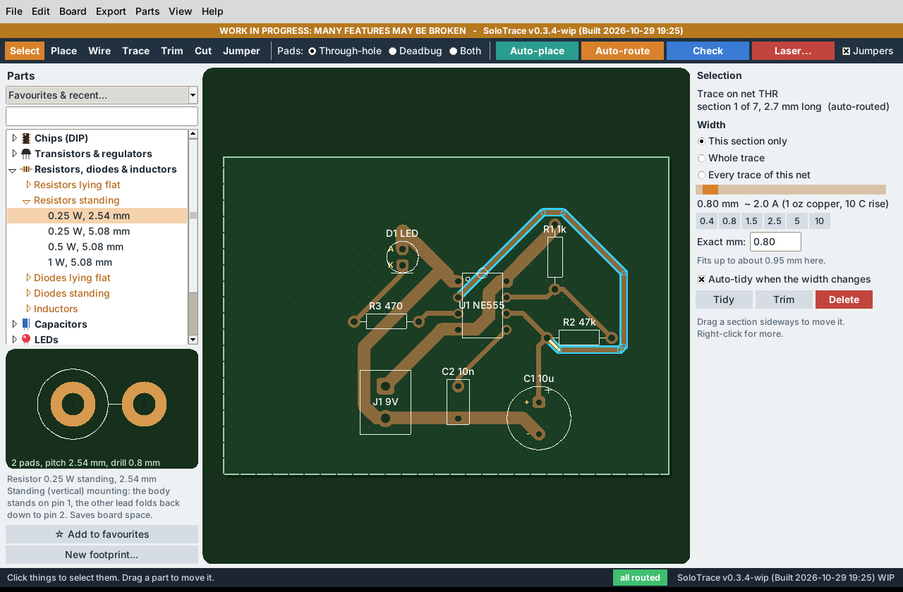](docs/images/gui-routed.webp)

*Screenshots are of the real program running on a Linux test machine with the built-in example boards.*

> **Licence and no warranty.** Copyright Matthew Armstrong. Licensed under the [PolyForm Noncommercial License 1.0.0](LICENSE.md): free to use, change and share for non-commercial purposes; commercial use needs separate permission. It is **source-available, not open source**. GitHub shows the licence as "Other". This is not legal advice. The software is provided **as is, with no warranty and no liability**. Third-party parts keep their own licences ([THIRD_PARTY.md](THIRD_PARTY.md)).
>
> **Safety.** Etching chemicals burn skin and eyes. A diode laser can blind you and start fires, and paint, resist and etchant fumes are harmful: wear laser safety glasses rated for your module, ventilate, never leave a running laser alone. The laser G-code has **never been run on a real machine**. Check every print against your real parts before etching.

## What exists and what does not

| Area | Status |
| --- | --- |
| Place, wire, trace, trim and jumper tools, undo/redo, pan/zoom, flip view | Works in tests and the screenshots; lightly tested by hand |
| Right-click menus (trim, split, tidy, width, rotate, duplicate, wire from a pin, route one net...) | Works in tests and the screenshots |
| Rigid wires (Shift + Wire): a direct power trunk that the rest of the net branches off | Works in tests and on the demo; first suggested from real use |
| Auto-route retries (best of up to 6 net orders), jumpers optional globally or per net | Works on the test boards; slower (up to about 12 s plus one try) |
| Cut tool: one click removes a piece of trace from joint to joint (Shift: between two points) | Works in tests |
| Favourites & recently placed parts; Shift + click turns a part while placing | Works in tests |
| Branches stay joined when a trunk is widened, tidied or dragged; DRC warns about hanging trace ends | Works in tests and on rebuilds of real boards |
| Board > Keep traces out from under parts | Works on the test boards; can add jumpers on cramped boards |
| Pin labels (B C E, G D S, K A, IN GND OUT, optocoupler and DIP layouts) and part values on the board | Works; layouts are the common ones for each shape, **check your datasheet** |
| Dragging a trace section sideways (neighbours follow, 45° rules kept) | Works in tests; lightly tested by hand |
| 90 through-hole parts in a form-factor tree with a live preview, footprint wizard, KiCad `.kicad_mod` import | Works; some parts excluded on purpose (see below) |
| Trace width slider 0.4–10 mm (segment, trace or net) + current readout + "fits up to" hint | Works |
| Wide traces leave pads straight and end on the pad centre (auto-tidy) | Works on the test boards; may leave a trace as it was when the tidy shape does not fit |
| Deadbug (surface-solder, no-drill) pads, per part or per pad | Works |
| Copper islands (Island tool): round or rectangular pads you drop, drag and resize; pins on an island join it | Works in tests and the screenshots; new in 0.4.0, not yet used on a real board |
| Ground fill for RF / Manhattan boards: the board is ground copper with a gap round every other net, floating fill removed | Works in tests, the examples and an independent Gerber reader; new in 0.4.0, **never etched yet** |
| Chamfered corners everywhere + DRC | Works |
| Auto-place and auto-route with jumper fallback | Works on the three demo boards and random test boards; **pure Python, can be slow** on big boards |
| Gerber + drill zip, 1:1 PDF/SVG, BOM CSV, netlist text | Written and re-read by an independent Gerber library in tests; **not opened in a fab's own viewer** |
| Laser G-code (negative / isolation / positive, test cards, frame file) | Geometry checked in tests; **never run on a real Elegoo Phecda** |
| Windows and macOS launchers, GitHub workflows | **Not run** (written but untested on those systems) |
| Floating slider pop-up beside the cursor | **Not built**: the slider is in the right-hand panel |
| Full PathFinder-style negotiated routing, topological router, C++ speed-up | **Not built** (see [DESIGN_NOTES.md](DESIGN_NOTES.md)) |
| Soldermask and copper-pour layers, multi-layer boards, SMD | Out of scope |

## Install and run

### 1. Double-click this

| System | Double-click | What it needs |
| --- | --- | --- |
| Linux | `SoloTrace-Linux.sh` (if asked, choose **Run**) | `python3` and `python3-tk` |
| Windows | `SoloTrace-Windows.bat` | Python 3.8+ from [python.org](https://www.python.org/downloads/windows/) with "tcl/tk" ticked |
| macOS | `SoloTrace-Mac.command` (first time: right-click > Open) | Python 3.8+ from [python.org](https://www.python.org/downloads/macos/) (the Apple one has an old Tk) |

If something is missing, the launcher shows a message with the exact fix. Nothing else is needed: SoloTrace uses only the Python standard library and sends nothing over the network.

Linux Mint / Ubuntu / Debian: `sudo apt install python3 python3-tk`. If the double-click does nothing, right-click the file > Properties > Permissions > "Allow executing as program", or run it from a terminal.

### 2. From a terminal

```
python3 src/main.py                  # open the editor
python3 src/main.py --version        # version line
python3 src/main.py --demo           # open the 555 example
python3 src/main.py demo "5 V regulator" board.solotrace
python3 src/main.py route board.solotrace routed.solotrace
python3 src/main.py islands board.solotrace rf.solotrace --deadbug   # ground fill on (--off turns it off)
python3 src/main.py export routed.solotrace --gerber out.zip --pdf out.pdf --laser out.gcode --mode negative
python3 src/main.py selftest         # run the tests
```

The first time it starts it shows a safety and work-in-progress notice; tick the box and click **I agree**. Closing that window quits.

## Quick tour: your first board in 5 minutes

1. **File > Open example > 555 LED flasher** (or **File > New board** and set a size).
2. **Place parts:** pick from *Favourites & recent* at the top of the parts panel, or open a group in the parts panel on the left (the little arrows show the sub-types, such as *Resistors standing*), pick a part, check the drawing under the list, then click on the board. Or type in the search box (`dip 8`, `to-220`, `standing`). `R` or Shift + click turns the part, `Esc` stops placing. Star parts you use a lot with the button under the preview.
3. **Wire:** press `W`, click one pin, then another (or drag from pin to pin). A yellow rubber-band line shows the connection. Hold **Shift** for a **rigid wire** (see below). Click a rubber-band line to name its net or give it a class (Signal 0.8 mm, Power 2 mm, High current 5 mm; change them in Board > Board size and rules).
4. **Auto-place, then Auto-route** (toolbar). A progress bar with **Cancel** shows while it works. Routes use 0°, 45° and 90° moves, and a 90° turn is always built as two 45° turns (a chamfer). If a trace can't get through, a **wire-link jumper** (blue dashed) is added on the component side.
5. **Label:** select a part and type its *Value / type* (NE555, BC547, 10k...), and pick its *Pin labels* (B C E, G D S, IN GND OUT...).
6. **Tweak:** drag a trace section sideways to move it, use **Trim** (`X`) to cut a section out, and **right-click** anything for its menu.
7. **Check**, then **Export**.

**Quick and dirty RF (Manhattan / deadbug):** *File > Open example > Manhattan RF amplifier (copper islands)*. Press `I` and click to drop copper islands, sit the parts' pins on them, and tick *Board > Ground fill*. No traces needed.

[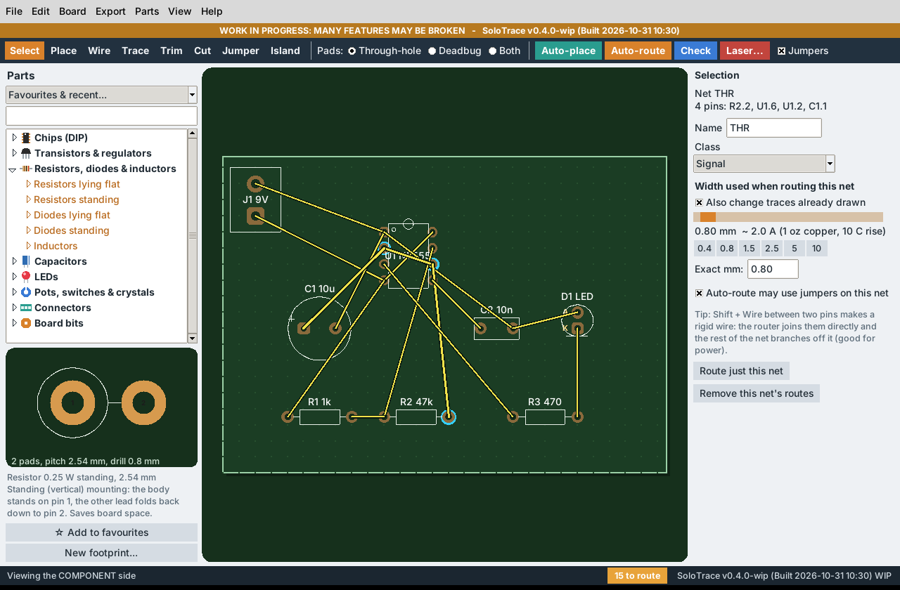](docs/images/gui-ratsnest.webp)

### Feature by feature

**Library and parts.** 90 parts, sorted by shape (form factor) rather than by maker code. Each group has an arrow that opens its sub-types:

| Group | Sub-types |
| --- | --- |
| Chips (DIP) | Narrow (7.62 mm rows) DIP-4 to DIP-28, wide (15.24 mm rows) DIP-28 and DIP-40 |
| Transistors & regulators | TO-92, TO-220 (2-pin, 3-pin, with heatsink outline), TO-247 / TO-3P |
| Resistors, diodes & inductors | Resistors lying flat (1/4 W to 5 W), **resistors standing (1/4 W at 2.54 and 5.08 mm, 1/2 W and 1 W at 5.08 mm)**, diodes lying flat and standing, axial and radial inductors |
| Capacitors | Ceramic disc, film / box, electrolytic |
| LEDs | 3 mm and 5 mm |
| Pots, switches & crystals | Inline pots (2.54 and 5.08 mm), triangle trimmer, 6 mm tactile switch, HC-49 crystal |
| Connectors | Pin headers 1-row and 2-row, screw terminals, JST-XH |
| Board bits | Wire links, mounting holes, solder and surface pads |
| My parts | Parts you made or imported |

Click a part and a drawing of it (copper, holes, outline, pin numbers, pitch and drill) appears under the list, in the sidebar, with no pop-up. Names say what the part is ("Electrolytic cap, 5 mm pitch"), not an obscure model number. Left out on purpose because their sizes vary too much between makers: relay, USB-B, barrel jack, buzzer, fuse holder, panel pots with lugs, TO-126, bridge rectifiers. Make those with the wizard. Body outlines, the inductor, pot and trimmer layouts, and the standing-part pitches are generic: check them against your real part.

**Your own parts.** *Parts > New footprint...* opens the wizard: type a pad table (name, x, y, pad size, drill), or click on the canvas to drop pads, or start from a DIP or header preset, then save. Saved parts live in `~/.solotrace/parts` (*Parts > Open my parts folder*). *Parts > Import KiCad .kicad_mod...* reads the text format of a KiCad footprint (through-hole pads and silkscreen lines only).

[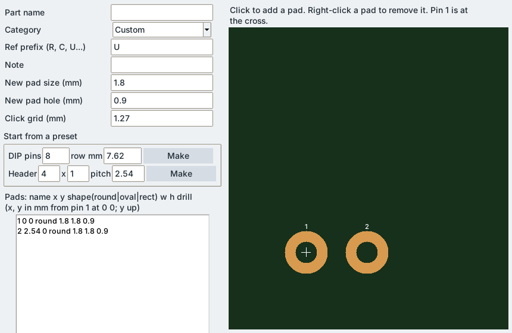](docs/images/footprint-wizard.webp)

**Trace width.** Press `T` and click along the board to draw a trace (`Enter`, a double-click or *Finish trace here* on the right-click menu finishes it; corners are chamfered for you). To change a width, click a **trace section** on the drawing, or click a **yellow rubber-band line** to set the width of a whole net, then drag the **slider** in the right panel (0.4–10 mm; preset buttons 0.4, 0.8, 1.5, 2.5, 5, 10). Choose whether it applies to the section, the whole trace or the whole net. The panel shows roughly how many amps that width carries (IPC-2221 outer-layer formula; board settings give copper weight and temperature rise; a guide only) and how wide the trace can go where it is before it breaks the clearance rule.

**Rigid wires (power trunks).** A net with more than two pins is normally routed by joining the nearest pins first, so a ground net can end up as one long chain (transistor to capacitor to terminal). If you want a direct trace between two particular pins, hold **Shift** while wiring them (click or drag), or right-click a pin > *Rigid wire from this pin*, or right-click an existing rubber band > *Make ... rigid*. The router routes every rigid pair first, as its own pin-to-pin trace, then connects the rest of the net to the nearest point of that trunk, so a capacitor becomes a short branch. "Rigid" fixes *which* two pins are joined, not the path: the trunk bends round other parts like any trace, can be moved by a re-route, and you can drag or cut it. Rigid rubber bands are thicker and orange. Once routed, the trunk is drawn in the same copper colour as everything else, so joints look like the one piece of copper they will be, with a thin dashed orange line down its middle to show it is a rigid wire. Branches stop inside the trunk instead of poking out of its far side, and when you drag a trunk sideways the branches joined to it move with it and stay joined. The net panel lists the rigid pairs, each with a *make normal* button.

[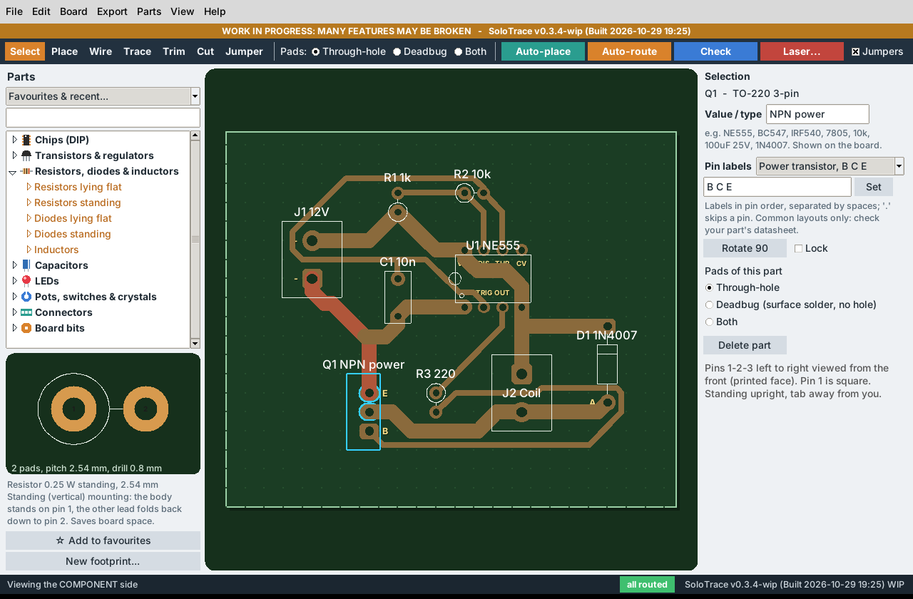](docs/images/gui-pin-labels.webp)

**Copper islands (Island tool, `I`).** Free-standing pads for Manhattan / deadbug building. Click on the board to drop one (5.08 mm square to start), or drag to draw one any size; Shift + click switches new islands between rectangular and round. With *Select*, drag an island to move it (0.635 mm steps, so it can sit under pins) and drag one of its white corner squares to resize it while the opposite corner stays put. The right panel takes an exact width, height and corner cut (rectangles get 45 degree corners like everything else; a round island with a different width and height is an oval), offers square/circle sizes from 2.54 to 15.24 mm, and has *Turn 90*, *Duplicate* (`Ctrl+D`) and *Delete*; arrow keys nudge it. Right-click an island for the same choices, or right-click empty board > *Add a copper island here*.

An island has no net of its own: it **joins the net of whatever touches it**, a pin, a trace or a jumper pad, and islands that touch each other share a net. So sit a part's pins on islands (deadbug pads make that easy) and the connection is made, with no trace. The panel says which net an island is on and which pins sit on it. If pins of two different nets end up on one island, that is a short and *Check* reports it. The router treats islands as copper and routes round them, and they appear in every export.

[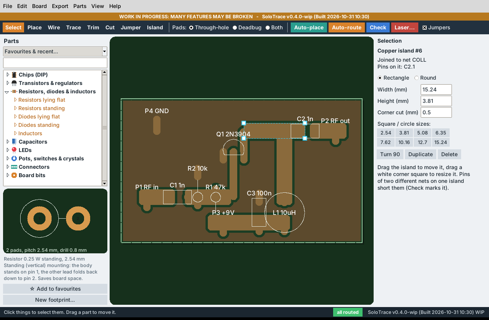](docs/images/gui-islands.webp)

**Ground fill (Board > Ground fill).** For quick and dirty RF and fast analogue: the whole board becomes copper, used as ground, and every other net is cut free from it with a gap. Settings are under *Board > Ground fill settings...*:

- **Ground net:** guessed (a net called GND, 0V, VSS, ground... otherwise the net with the most pins), or pick one; the net panel also has *Use this net as the ground fill*. The ground net is joined by the fill, so Auto-route does not route it, and its old automatic traces are removed when you turn the fill on.
- **Gap** round everything else (default 0.6 mm, never less than the board's copper-to-copper gap). For laser etching keep it at least 3 to 4 line intervals.
- **Fatten other nets' copper** by up to this much (default 1 mm): routed traces and pads grow into wide, low-inductance patches, but only where that keeps the gap from other nets, ground copper and the board edge. Copper islands you placed keep their size.
- **Remove floating fill** (on by default): a piece of fill that no ground pin sits on, boxed in by other nets, is cut away rather than left as floating copper. A ground pin that sits on a piece of fill cut off from the rest gets a yellow rubber band; join it with a trace or a jumper.
- Turning the fill on offers to make every pad a **deadbug pad**, since such boards are usually built with the parts soldered straight onto the copper.

The fill is drawn in the editor and is in the Gerber, the PDF/SVG prints and the laser G-code. In negative laser mode the laser then burns only the gaps (much faster); isolation mode burns the same thing on such a board.

[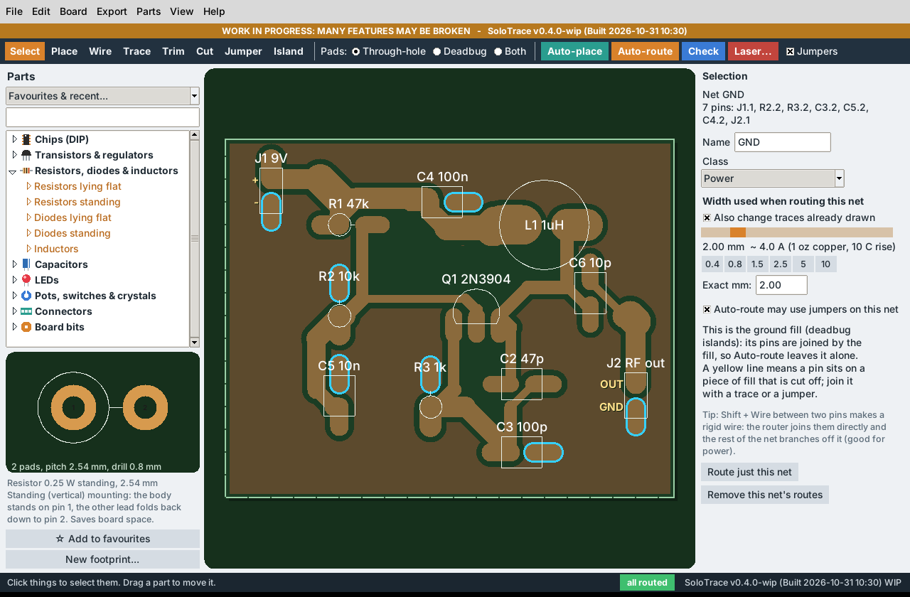](docs/images/gui-ground-fill.webp)
[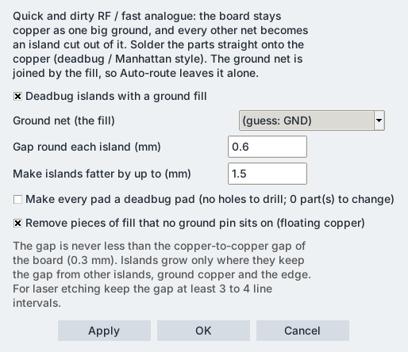](docs/images/islands-dialog.webp)

**Values and pin labels.** Select a part: *Value / type* at the top of the right panel takes anything (NE555, BC547, IRF540, 7805, 10k, 100uF 25V) and is shown next to the part name on the board; double-click a part to jump to it. *Pin labels* offers the common layouts for that shape, not specific part numbers:

| Shape | Layouts offered |
| --- | --- |
| TO-92 | E B C, C B E, B C E, D G S, G D S, S G D, small regulator OUT GND IN / IN GND OUT |
| TO-220 3-pin | power transistor B C E, MOSFET G D S, IGBT G C E, regulator IN GND OUT, adjustable regulator ADJ OUT IN, negative regulator GND IN OUT, triac MT1 MT2 G, dual diode A K A |
| TO-220 2-pin | diode K A / A K |
| TO-247 | G D S, G C E, B C E |
| DIP-4 / DIP-6 | optocoupler A K E C; optocoupler with base pin; opto-triac |
| DIP-8 | 555-style timer, dual op-amp, single op-amp, dual optocoupler |
| DIP-14 / 16 / 20 | logic GND and VCC pins; quad op-amp (DIP-14) |
| Pots, connectors | 1 W 3, CCW W CW; + -, - +, AC AC, IN OUT, V+ GND V-, IN GND OUT |

Or type your own in pin order, separated by spaces (`.` skips a pin). Diodes and LEDs show K A, electrolytics + -, without asking. Pin orders differ between makers, so **always check the datasheet** of the part you have. Labels are shown in the editor; they are not yet written into the Gerber silkscreen.

**Wide traces are tidied.** When a trace is 1.2 mm or wider, SoloTrace makes it leave each pad with a straight vertical or horizontal run (about the pad radius plus the trace width) before it turns, ends it exactly on the pad centre, and makes the chamfers bigger where there is room. This happens after auto-routing and, with *Auto-tidy when the width changes* ticked (the default), whenever you change a width. If the tidier shape would touch other copper the trace is left as it was, and the clearance problem is marked in red. *Tidy* (right panel or right-click) does it on demand; *Edit > Tidy all traces* does the whole board.

[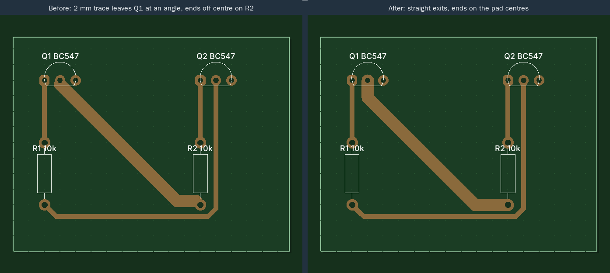](docs/images/wide-trace-tidy.webp)

**Cutting a piece out of a trace.** Press `C` and click a trace: the piece under the mouse goes, from the joint before it to the joint after it (a pad, a place where another trace meets it, a jumper pad). The rest of the trace and of the net stays. While you hover, the piece that would go is shown in red. Right-clicking a trace only opens its menu; rest the mouse on *Cut this piece* to see the piece in red, and choose it to remove it. To cut between two points of your own choosing, Shift + click the first point and Shift + click the second (or right-click > *Cut between two points*); `Esc` cancels.

**Moving, trimming and splitting traces.** With *Select*, drag a trace section sideways: it moves parallel to itself and the sections either side stretch to follow at their own angle, so no 90° corner appears. Ends on pads stay put (a 45° link is added). **Trim** (`X`, or right-click > *Trim this section*) cuts one section out and leaves the rest as separate pieces; *Split trace here* breaks a trace in two without removing copper. A trace you have moved or trimmed counts as hand-drawn, so Auto-route keeps it. `Ctrl+Z` undoes any of this.

**Right-click menus.** Right-click (without dragging) on a trace, pin, part, rubber-band line, jumper or empty board for the actions that fit: widths, trim, split, tidy, highlight or re-route the net, rotate either way, duplicate, lock, pad styles, wire or trace from a pin, disconnect, delete, and Undo/Redo. Right-drag still pans.

[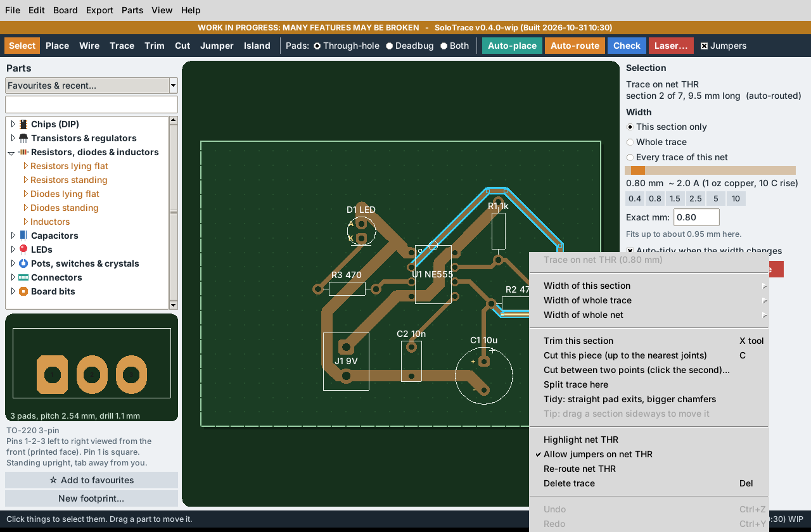](docs/images/gui-context-menu.webp)

**Small helpers.** Hover over copper to light up its whole net (the net name shows in the corner). Arrow keys nudge the selected part by 1.27 mm (`Shift`: 2.54 mm), `Ctrl+D` duplicates it, `Shift+R` turns it back. *File > Open recent* lists your last boards. While a board has unsaved changes it is saved every 2 minutes to `~/.solotrace/autosave.solotrace`; *File > Recover autosave* opens it (the file is removed when you quit normally). Hover over a toolbar button for a hint. The status bar shows the cursor position in mm and a green *all routed* or orange *N to route* badge.

**Pads: through-hole or deadbug.** Pick *Through-hole*, *Deadbug* or *Both* in the toolbar for new parts, or change it for a placed part in the right panel, or for one pad ("This pad only"). Deadbug pads have **no hole** and are drawn as a long oval that sticks out from the part so you can bend the lead flat and solder it on the copper side. "Both" keeps the hole *and* the extra copper.

[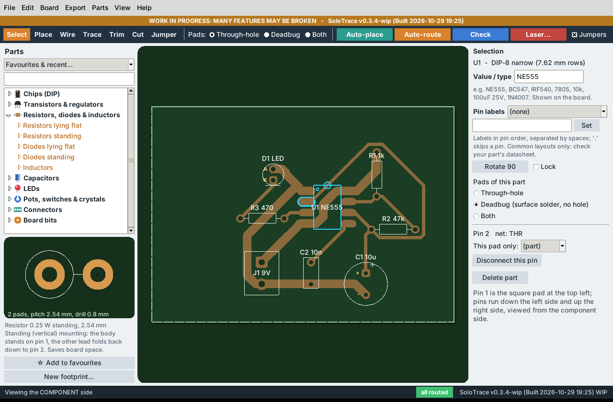](docs/images/gui-deadbug.webp)

**Auto-place.** Simulated annealing that moves, rotates and swaps unlocked parts to shorten the ratsnest and cut crossings. Tick **Lock** on a part to keep it where it is.

**Auto-route.** A grid router that remembers its heading, so it prefers straight runs and clean 45° bends instead of staircases. Wide nets are routed first, and it prefers not to run under part bodies. If a net is blocked it tears up the nets in the way and retries; as a last resort it adds a jumper, unless you unticked **Jumpers** in the tool bar or for that net. The whole job is tried with up to six different net orders (about 12 seconds at most, plus the try in progress) and the best result is kept; it stops early when a try routes everything without jumpers. Traces you drew by hand are kept. *Board > Remove automatic routes* undoes only the automatic ones.

**Jumpers.** Press `J` to add one by hand. They are plain wire links on the component side, in 2.54 mm steps from 5.08 mm. They are listed in the DRC window.

**View.** `M` flips between the **component side** (how you place parts) and the **copper side** (how the etched board looks from below). Wheel zooms, right or middle drag pans, right-click opens the menu, `F` fits the board.

[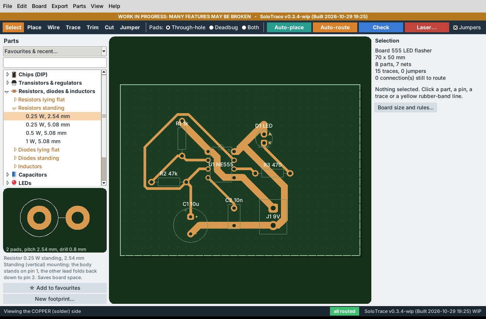](docs/images/gui-copper-side.webp)

**DRC.** *Check* lists trace ends that are not joined to anything ("dangling"), copper too close to other copper or the board edge, parts sticking out of the board, traces thinner than the minimum, turns sharper than 45°, drilled pads with too little copper ring, jumpers that are the wrong length or cross each other, and pins that are not connected yet. Click a row to jump to it on the board.

**Exports (Export menu).**

| Output | Use |
| --- | --- |
| Gerber + drill (zip) | Copper (bottom), board edge, silkscreen, Excellon drill. Single layer; **no soldermask layer** |
| 1:1 PDF / SVG, mirrored | Toner transfer or photo-resist film: the copper side as you will see it. Always print at 100 % and **measure a known distance** before etching |
| 1:1 PDF, design view | Component-side print |
| Bill of materials (CSV) | Parts grouped by name and value |
| Netlist text | Round-trip text format for a quick board from a text editor |
| Laser G-code (Elegoo Phecda) | See below |

## Laser etching with the Elegoo Phecda (gantry diode laser)

**Read this first.** A diode laser cannot remove bare copper. The method is: **paint** the copper, let the laser **burn the paint away** where copper must go, **etch**, then clean the paint off. Nobody has run these files on a Phecda yet. Treat every default as a starting guess and use the test cards.

1. Finish the board and run DRC. Open **Export > Laser G-code (Elegoo Phecda)...**
2. **Mode**
   - **Negative** (default): burns everything that is *not* copper, so paint is left only on the traces and pads. Slowest, cleanest.
   - **Isolation**: burns only a band of `gap` mm around the copper. Fast; leftover paint between bands must be cleared by hand or by the etchant.
   - **Positive**: burns the copper shapes themselves (for a negative-working resist or marking).
3. **Adjust** (all live-previewed):
   - *Trace adjust* (mm per side): positive grows the copper, negative thins it and widens every gap between traces. Use this to correct for the laser's spot size and your etch.
   - *Gap* (isolation band width) and *Border* (keep paint at the board edge).
   - *Line interval* (default 0.08 mm; the module's spot is about 0.06–0.13 mm depending on model), *feed* (default 1500 mm/min), *power* (default 70 % of S max), *passes*, *crosshatch* (second pass at 90°), *bidirectional* scanning, *M4 dynamic power* (default) or *M3 with overscan*, and *drill dots* (a tiny burn at every hole centre as a drilling guide).
4. Click **Save G-code...**. Also use **Frame file...** (traces the board outline at 1 % power so you can line up the paint) and, on first use, **Speed/power test...** and **Trace/gap test...** (a grid of squares and a ladder of fine traces and gaps).
5. In LaserGRBL or LightBurn: jog the laser to the **lower-left corner of the board as seen from the copper side**, set work zero there, open the file, check the preview, run the frame, then burn. The exporter mirrors X for you because the design view is the component side.
6. Controller assumptions: GRBL-style, `$30` equal to the S max in the dialog (default 1000) and `$32=1` (laser mode). The Elegoo manual names LaserGRBL and LightBurn but does not say "GRBL"; see [docs/research/phecda-laser-notes.md](docs/research/phecda-laser-notes.md).

[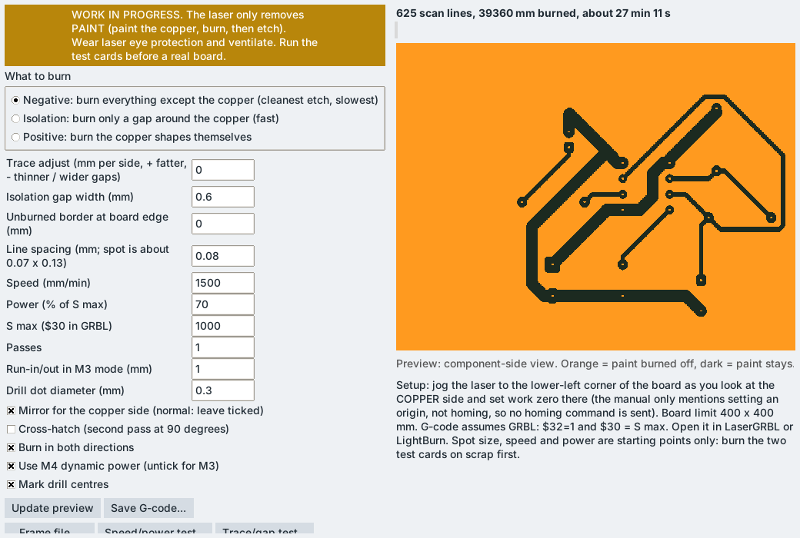](docs/images/laser-negative.webp)
[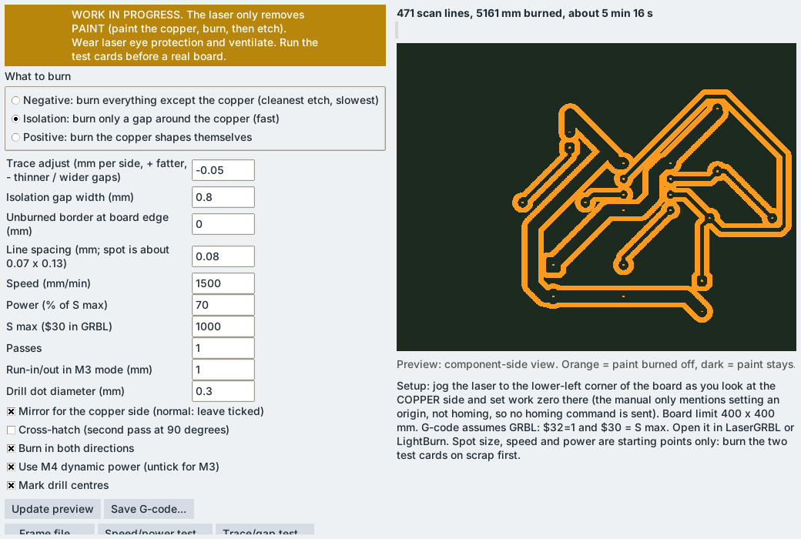](docs/images/laser-isolation.webp)

Examples to look at without installing anything: [examples/](examples/) has four boards, each with its `.solotrace` file, Gerber zip, 1:1 copper-side SVG and PDF, BOM and laser G-code in both modes, plus [test cards](examples/test-cards).

## Troubleshooting

| Problem | Try |
| --- | --- |
| Double-click does nothing on Linux | Right-click > Properties > Permissions > allow executing; or `bash SoloTrace-Linux.sh` |
| "tkinter is missing" | `sudo apt install python3-tk` (Linux), reinstall Python with "tcl/tk" ticked (Windows), install Python from python.org (macOS) |
| macOS says the file is from an unidentified developer | Right-click the `.command` file > Open > Open (first time only) |
| Window looks cut off | Maximise it or make it larger; the panels were laid out on a 1280 x 800 window |
| A wide trace still leaves its pad at an angle | The straight exit did not fit next to the neighbouring pads (common on 2.54 mm pitch parts above about 2.5 mm width). Make it narrower near the pad (*Width of this section*) or move the part, then *Tidy* |
| Dragging a trace does nothing | Use the *Select* tool and press on the trace itself (not on a pad); drag sideways, the section only moves at right angles to itself |
| Right-click pans instead of opening the menu | Click without moving the mouse; a right-drag pans |
| A trace runs straight through the middle of a chip | Tick *Board > Keep traces out from under parts* and route again (it may need a jumper instead) |
| *Check* says "pad ... touches island #n" | That island has pins of two nets on it (a short). Make it smaller, move it, or split it into two islands with a gap |
| An island says "not joined to anything yet" | No pin, trace or jumper pad touches it. Drag it under a pin, or make it bigger |
| Ground fill: a yellow line from a ground pin | That pin sits on a piece of fill cut off by other nets. Join it with a trace or a jumper, or move parts so the fill can reach it |
| Ground fill: big bare areas | Fill that no ground pin sat on was cut away (floating copper). Untick *Remove pieces of fill...* in *Board > Ground fill settings* to keep it |
| A short stub hangs off a trace | *Check* lists it as "dangling"; use Cut or Trim to remove it, or re-route the net |
| Auto-route adds jumpers you do not want | Untick **Jumpers** in the tool bar (whole board) or in the net panel (one net), then route again; finish what is left by hand |
| Auto-route leaves nets unrouted | Make the board bigger, lock fewer parts, run Auto-place again, lower the width of wide nets, or finish by hand with the Trace tool; unrouted nets stay as yellow lines |
| Drawing feels slow | Update to 0.2.1 or later (only the moving layer is redrawn now). Turn off *View > Show grid* on very big boards |
| Auto-route is slow | It is pure Python; boards over about 40 parts can take tens of seconds on a slow CPU. Press Cancel, or route a few nets at a time |
| Print is the wrong size | Print at 100 % / "actual size", no "fit to page"; check a known distance with calipers |
| Printed pinout is mirrored | Use the **mirrored** PDF for toner transfer; the design view is the component side |
| Laser burns the wrong place or mirrored | Work zero must be the lower-left of the board as seen from the **copper** side; check the preview in your laser software |
| Laser power looks wrong | Make `$30` match the S max in the dialog and set `$32=1` |
| Fab rejects a Gerber | Tell us with an issue and attach the zip; only an independent Python Gerber reader has been used so far |

## Known limitations

- **Work in progress.** Expect bugs. Back up your boards (`.solotrace` files are plain JSON).
- Laser output is untested on hardware; speeds, powers and spot sizes are assumptions. See [DESIGN_NOTES.md](DESIGN_NOTES.md).
- The router is pure Python and is not a full negotiated-congestion router. A random 40-part, 178-pin stress board left 2 nets unrouted and needed 25 jumpers (about 33 s to route and 13 s to place on the development sandbox; **not measured on a 7th-gen Core i3 yet**). The logic demo needs 7 to 10 jumpers depending on the placement. With retries (0.3.1) Auto-route takes up to about 12 seconds plus one try, more on a slow laptop; press Cancel to keep the best result so far.
- Deadbug pads and body outlines are approximations. Check clearances with your real parts.
- No soldermask output, no copper fills, no text on copper, and parts cannot be flipped to the other side.
- The width slider is in the right-hand panel, not a floating pop-up.
- Dragging moves one section at a time; there is no push-and-shove of neighbouring traces, so a dragged trace can end up too close to others (it is marked in red).
- The tidy step only reshapes the first few sections at each end of a trace; it does not re-route.
- A trace cannot be thinner near a pad than elsewhere when auto-routed ("neck-down"), so a power net wider than about 2.4 mm cannot leave the middle pin of a TO-220 or TO-92 (2.54 mm pitch) with the 0.3 mm clearance: the net stays unrouted. Use 2 mm for such nets, or narrow that one section by hand.
- Copper islands and the ground fill are new in 0.4.0 and have not been etched or lasered on a real board. Islands are only rectangles (with cut corners), circles and ovals; there are no other shapes yet, and no text on copper.
- With the ground fill on, every edit re-works the fill (about 0.1 to 0.3 s on the example boards). While you drag something, the floating-fill check waits until you let go.
- Pin labels and values are not yet part of the silkscreen in the Gerber, PDF or SVG exports.
- Only the tests and the screenshots have exercised the GUI; Windows and macOS have not been run at all.

## More

- [HOW_IT_WORKS.md](HOW_IT_WORKS.md): what it reads and writes, the coordinates, the router and the laser engine in plain English
- [DESIGN_NOTES.md](DESIGN_NOTES.md): decisions, rejected ideas, measurements, what is untested
- [docs/research/](docs/research): the original research and plan, and the Phecda notes
- [CHANGELOG.md](CHANGELOG.md) · [CONTRIBUTING.md](CONTRIBUTING.md) · [SECURITY.md](SECURITY.md)

Project page (after you enable GitHub Pages): `https://The-Dorkknight.github.io/solotrace/`
